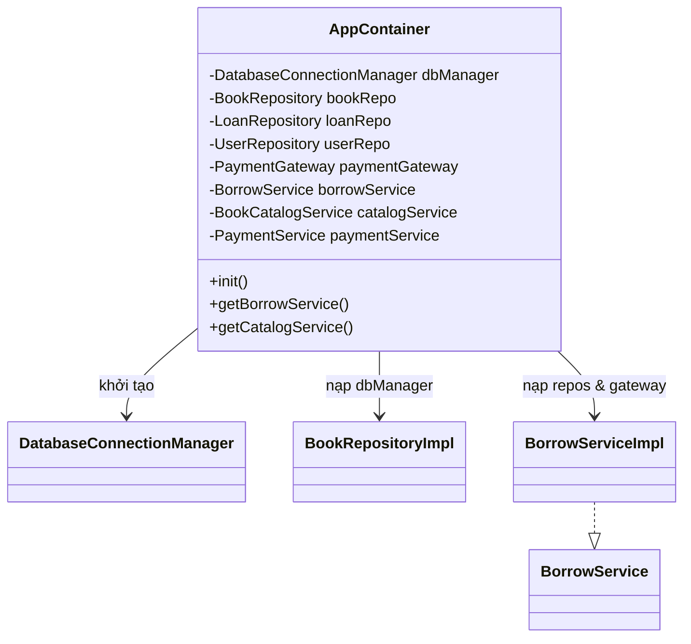
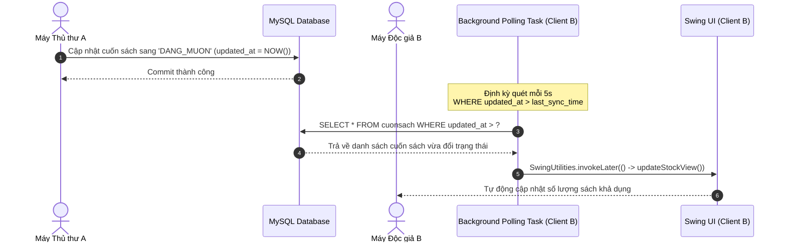

# Version: 1.1 | Last updated: 2026-10-27 | Owner: Architecture Team | Related files: ../AGENTS.md, DATABASE_SCHEMA.md, BUSINESS_RULES.md, PROJECT_STATUS.md

# ARCHITECTURE.md — Kiến trúc Hệ thống XimiLib (Clean Architecture)

## 1. Cấu trúc Cây Thư mục (Package Tree)
Toàn bộ mã nguồn hệ thống được tổ chức theo Clean Architecture đặt dưới package gốc `com.ximilib`:

```text
sources/src/main/java/com/ximilib/
├── domain/                                 # Chứa quy tắc nghiệp vụ cốt lõi, độc lập hoàn toàn với framework/UI/DB
│   ├── model/                              # Entities, Value Objects, Enums (User, Book, Copy, Loan, Fine)
│   │                                       # [ĐẶT]: Pure POJO, logic bất biến; [CẤM]: Import Swing, JDBC, SQL
│   ├── repository/                         # Các Repository Interfaces định nghĩa hợp đồng lưu trữ
│   │                                       # [ĐẶT]: Interface CRUD; [CẤM]: Mã nguồn SQL, Connection, ResultSet
│   ├── event/                              # Domain Events và Event Listeners Interfaces
│   │                                       # [ĐẶT]: BookStockChangedEvent; [CẤM]: Swing UI classes
│   └── exception/                          # Custom Domain Exceptions (NotFoundException, BusinessRuleException)
│                                           # [ĐẶT]: Lớp ngoại lệ cha; [CẤM]: Mã HTTP/SQL trực tiếp
├── application/                            # Điều phối các Use Case và luồng nghiệp vụ
│   ├── service/                            # Application Services thực thi UC-01 đến UC-09
│   │                                       # [ĐẶT]: Transaction boundary, DTO transformation; [CẤM]: GUI components
│   ├── dto/                                # Data Transfer Objects (Request/Response giữa Presentation & Application)
│   │                                       # [ĐẶT]: Request/Response POJO/Records; [CẤM]: Entity domain trực tiếp
│   └── port/                               # Interfaces giao tiếp cổng thanh toán ngoại vi (PaymentGateway)
│                                           # [ĐẶT]: Outbound ports; [CẤM]: Mã triển khai thư viện bên ngoài
├── infrastructure/                         # Triển khai kỹ thuật cụ thể (Database, External APIs, Config)
│   ├── persistence/                        # Triển khai Repository bằng Pure JDBC + HikariCP
│   │   ├── impl/                           # BookRepositoryImpl, LoanRepositoryImpl (Thực thi interface từ domain)
│   │   ├── mapper/                         # ResultSetMapper biến đổi dòng SQL thành Domain Entity
│   │   └── connection/                     # DatabaseConnectionManager quản lý HikariDataSource và Transaction Context
│   ├── gateway/                            # Triển khai cổng thanh toán SePay VietQR (SePayPaymentGateway)
│   │                                       # [ĐẶT]: HTTP Client gọi API SePay; [CẤM]: Chứa logic nghiệp vụ mượn trả
│   └── config/                             # Composition Root, DI Container thủ công, đồng bộ nền
│                                           # [ĐẶT]: AppContainer, PollingScheduler; [CẤM]: Business rules
├── presentation/                           # Giao diện người dùng Java Swing FlatLaf (In-App Modal Overlay)
│   ├── view/                               # JFrame, JPanel màn hình (LoginForm, MainDashboard, BookCatalogView)
│   │                                       # [ĐẶT]: Layout UI, Component binding; [CẤM]: SQL query, Transaction, OS JDialog
│   ├── component/                          # In-App Overlays & UI components (KpiCard, ActiveLoanCard, DigitalCardPopupPanel, UserProfileModalPanel, BookFormModalPanel)
│   └── util/                               # UiModalHelper (DJ-Raven Suite), UITheme, IconFactory, Swing EDT helpers
└── Main.java                               # Điểm vào chính của ứng dụng: khởi tạo AppContainer và mở LoginForm
```

## 2. Quy tắc Phụ thuộc (Dependency Rule)
Các tầng bên trong không được phép biết bất kỳ thông tin nào về các tầng bên ngoài.

| Tầng (Layer) | Được phép import từ | Tuyệt đối cấm import từ |
|---|---|---|
| **Domain** | Thư viện Java Core chuẩn (`java.time`, `java.math`, `java.util`) | Application, Infrastructure, Presentation, `java.sql.*`, `javax.swing.*` |
| **Application** | Domain, Java Core | Infrastructure, Presentation, `javax.swing.*`, `java.sql.*` |
| **Infrastructure** | Domain, Application (các ports), thư viện bên thứ 3 (HikariCP, BCrypt, HTTP Client) | Presentation, Swing UI classes |
| **Presentation** | Application (Services, DTOs), Domain (Enums, Value Objects công khai), Swing/FlatLaf | Infrastructure (Repositories Impl, JDBC Connection), `java.sql.*` |

## 3. Repository Pattern
- **Quy ước:** Interface đặt tại `com.ximilib.domain.repository`, lớp triển khai thực tế bằng JDBC đặt tại `com.ximilib.infrastructure.persistence.impl`.
- **Ví dụ mẫu chuẩn (`BookRepository`):**

```java
// File: domain/repository/BookRepository.java
package com.ximilib.domain.repository;

import com.ximilib.domain.model.Book;
import java.util.List;
import java.util.Optional;

public interface BookRepository {
    Optional<Book> findById(int id);
    Optional<Book> findByIsbn(String isbn);
    List<Book> search(String keyword, Integer categoryId, int page, int pageSize);
    int save(Book book);
    boolean update(Book book);
    boolean softDelete(int id);
}
```

```java
// File: infrastructure/persistence/impl/BookRepositoryImpl.java
package com.ximilib.infrastructure.persistence.impl;

import com.ximilib.domain.model.Book;
import com.ximilib.domain.repository.BookRepository;
import com.ximilib.infrastructure.persistence.connection.DatabaseConnectionManager;
import com.ximilib.infrastructure.persistence.mapper.BookRowMapper;

import java.sql.*;
import java.util.ArrayList;
import java.util.List;
import java.util.Optional;

public class BookRepositoryImpl implements BookRepository {
    private final DatabaseConnectionManager connectionManager;

    public BookRepositoryImpl(DatabaseConnectionManager connectionManager) {
        this.connectionManager = connectionManager;
    }

    @Override
    public Optional<BookSummaryDto> findById(String bookId) {
        String sql = "SELECT s.*, t.Tentheloai, nxb.tennxb FROM sach s "
                   + "LEFT JOIN theloai t ON s.Matheloai = t.Matheloai "
                   + "LEFT JOIN nhaxuatban nxb ON s.Manxb = nxb.manxb "
                   + "WHERE s.Masach = ? AND s.IsDeleted = FALSE";
        try (Connection conn = connectionManager.getConnection();
             PreparedStatement ps = conn.prepareStatement(sql)) {
            ps.setString(1, bookId);
            try (ResultSet rs = ps.executeQuery()) {
                if (rs.next()) {
                    // Map sang BookSummaryDto
                }
            }
        } catch (SQLException e) {
            throw new RuntimeException("Lỗi truy vấn đầu sách: " + bookId, e);
        }
        return Optional.empty();
    }

    @Override
    public Optional<Book> findByIsbn(String isbn) {
        String sql = "SELECT * FROM sach WHERE isbn = ? AND trangthai != 'DA_XOA'";
        try (Connection conn = connectionManager.getConnection();
             PreparedStatement ps = conn.prepareStatement(sql)) {
            ps.setString(1, isbn);
            try (ResultSet rs = ps.executeQuery()) {
                if (rs.next()) return Optional.of(rowMapper.mapRow(rs));
            }
        } catch (SQLException e) {
            throw new RuntimeException("Lỗi truy vấn ISBN: " + isbn, e);
        }
        return Optional.empty();
    }

    @Override
    public List<Book> search(String keyword, Integer categoryId, int page, int pageSize) {
        StringBuilder sql = new StringBuilder("SELECT * FROM sach WHERE trangthai != 'DA_XOA'");
        List<Object> params = new ArrayList<>();
        if (keyword != null && !keyword.isBlank()) {
            sql.append(" AND (tensach LIKE ? OR isbn LIKE ?)");
            params.add("%" + keyword.trim() + "%");
            params.add("%" + keyword.trim() + "%");
        }
        if (categoryId != null && categoryId > 0) {
            sql.append(" AND matheloai = ?");
            params.add(categoryId);
        }
        sql.append(" ORDER BY masach DESC LIMIT ? OFFSET ?");
        params.add(pageSize);
        params.add((page - 1) * pageSize);

        List<Book> list = new ArrayList<>();
        try (Connection conn = connectionManager.getConnection();
             PreparedStatement ps = conn.prepareStatement(sql.toString())) {
            for (int i = 0; i < params.size(); i++) {
                ps.setObject(i + 1, params.get(i));
            }
            try (ResultSet rs = ps.executeQuery()) {
                while (rs.next()) list.add(rowMapper.mapRow(rs));
            }
        } catch (SQLException e) {
            throw new RuntimeException("Lỗi tìm kiếm sách", e);
        }
        return list;
    }

    @Override
    public int save(Book book) {
        String sql = "INSERT INTO sach (tensach, matheloai, manxb, namxuatban, giatien, mota, gioithieu, soluongtong, trangthai) " +
                     "VALUES (?, ?, ?, ?, ?, ?, ?, ?, ?)";
        try (Connection conn = connectionManager.getConnection();
             PreparedStatement ps = conn.prepareStatement(sql, Statement.RETURN_GENERATED_KEYS)) {
            ps.setString(1, book.getTitle());
            ps.setInt(2, book.getCategoryId());
            ps.setInt(3, book.getPublisherId());
            ps.setInt(4, book.getPublishYear());
            ps.setBigDecimal(5, book.getPrice());
            ps.setString(6, book.getDescription());
            ps.setString(7, book.getIntroduction());
            ps.setInt(8, book.getTotalQuantity());
            ps.setString(9, book.getStatus().name());
            ps.executeUpdate();
            try (ResultSet rs = ps.getGeneratedKeys()) {
                if (rs.next()) return rs.getInt(1);
            }
        } catch (SQLException e) {
            throw new RuntimeException("Lỗi thêm đầu sách", e);
        }
        return 0;
    }

    @Override
    public boolean update(Book book) {
        String sql = "UPDATE sach SET tensach = ?, matheloai = ?, manxb = ?, namxuatban = ?, giatien = ?, " +
                     "mota = ?, gioithieu = ?, soluongtong = ?, trangthai = ? WHERE masach = ?";
        try (Connection conn = connectionManager.getConnection();
             PreparedStatement ps = conn.prepareStatement(sql)) {
            ps.setString(1, book.getTitle());
            ps.setInt(2, book.getCategoryId());
            ps.setInt(3, book.getPublisherId());
            ps.setInt(4, book.getPublishYear());
            ps.setBigDecimal(5, book.getPrice());
            ps.setString(6, book.getDescription());
            ps.setString(7, book.getIntroduction());
            ps.setInt(8, book.getTotalQuantity());
            ps.setString(9, book.getStatus().name());
            ps.setInt(10, book.getId());
            return ps.executeUpdate() > 0;
        } catch (SQLException e) {
            throw new RuntimeException("Lỗi cập nhật sách: " + book.getId(), e);
        }
    }

    @Override
    public boolean softDelete(int id) {
        String sql = "UPDATE sach SET IsDeleted = TRUE WHERE Masach = ?";
        try (Connection conn = connectionManager.getConnection();
             PreparedStatement ps = conn.prepareStatement(sql)) {
            ps.setInt(1, id);
            return ps.executeUpdate() > 0;
        } catch (SQLException e) {
            throw new RuntimeException("Lỗi xóa mềm sách: " + id, e);
        }
    }
}
```

## 4. DI Wiring (Composition Root)
Hệ thống sử dụng **Pure DI** (Manual Dependency Injection) đóng gói trong `AppContainer`. Khởi tạo 1 lần duy nhất tại điểm bắt đầu chương trình (`Main.java`). [ASSUMPTION: Tránh dùng Spring/Guice để giảm dung lượng file thực thi, tăng tốc độ khởi động < 1s và dễ dàng giải trình bảo vệ đồ án].



```java
// File: infrastructure/config/AppContainer.java
package com.ximilib.infrastructure.config;

import com.ximilib.application.port.PaymentGateway;
import com.ximilib.application.service.*;
import com.ximilib.domain.repository.*;
import com.ximilib.infrastructure.gateway.SePayPaymentGateway;
import com.ximilib.infrastructure.persistence.connection.DatabaseConnectionManager;
import com.ximilib.infrastructure.persistence.impl.*;

public class AppContainer {
    private static AppContainer instance;

    // Infrastructure components
    private final DatabaseConnectionManager connectionManager;
    private final PaymentGateway paymentGateway;

    // Repositories
    private final BookRepository bookRepository;
    private final LoanRepository loanRepository;
    private final UserRepository userRepository;

    // Application Services
    private final AuthenticationService authService;
    private final BorrowService borrowService;
    private final BookCatalogService catalogService;

    private AppContainer() {
        // 1. Khởi tạo Infrastructure
        this.connectionManager = new DatabaseConnectionManager();
        this.paymentGateway = new SePayPaymentGateway();

        // 2. Khởi tạo Repositories
        this.bookRepository = new BookRepositoryImpl(connectionManager);
        this.loanRepository = new LoanRepositoryImpl(connectionManager);
        this.userRepository = new UserRepositoryImpl(connectionManager);

        // 3. Khởi tạo Services (Wiring)
        this.authService = new AuthenticationServiceImpl(userRepository);
        this.borrowService = new BorrowServiceImpl(connectionManager, loanRepository, bookRepository, userRepository);
        this.catalogService = new BookCatalogServiceImpl(bookRepository);
    }

    public static synchronized AppContainer getInstance() {
        if (instance == null) instance = new AppContainer();
        return instance;
    }

    public AuthenticationService getAuthService() { return authService; }
    public BorrowService getBorrowService() { return borrowService; }
    public BookCatalogService getCatalogService() { return catalogService; }
}
```

## 5. Cơ chế Đồng bộ Observer Pattern
### 5.1 Cấu trúc Event trong tiến trình
- **Event:** `BookStockChangedEvent(int bookId, int copyId, CopyStatus oldStatus, CopyStatus newStatus, Instant timestamp)`
- **Publisher:** `DomainEventPublisher` gọi khi thủ thư duyệt mượn/trả hoặc độc giả đặt sách thành công.
- **Subscribers:** `BookCatalogView`, `BorrowDeskView` đăng ký lắng nghe để cập nhật số lượng tồn kho trên giao diện.
- **Threading Model:** Nhận event ở background thread/service và bắt buộc điều hướng cập nhật giao diện thông qua `SwingUtilities.invokeLater()`.

### 5.2 Đồng bộ Đa Máy (Multi-Client Desktop Synchronization)
[ASSUMPTION]: Do hệ thống chạy mô hình Desktop Client qua mạng nội bộ LAN kết nối về MySQL tập trung, việc dùng Socket server riêng gây phức tạp triển khai. Hệ thống sử dụng cơ chế **DB Polling Scheduler** kết hợp trường `updated_at` trên bảng `cuonsach` (chu kỳ quét 5 giây/lần).



## 6. VietQR Payment Gateway (SePay Integration)
Hệ thống kết nối thanh toán tự động qua SePay với tài khoản ngân hàng cố định.

### 6.1 Giao tiếp Cổng thanh toán (PaymentGateway Interface)
```java
package com.ximilib.application.port;

import java.math.BigDecimal;

public interface PaymentGateway {
    // Bước (a): Sinh chuỗi định dạng URL hiển thị mã VietQR động
    String generateQrUrl(String bankCode, String accountNumber, BigDecimal amount, String paymentCode);

    // Bước (b): Đối soát giao dịch từ API SePay
    PaymentVerificationResult verifyPayment(String paymentCode, BigDecimal expectedAmount);
}
```

### 6.2 Quy trình Thanh toán & Đối soát
- **Bước (a) Sinh VietQR động:** Khi độc giả nộp phạt hoặc bồi thường, Client tạo mã `paymentCode = "XML" + maphieuphat`. URL ảnh mã QR được tạo từ template VietQR chuẩn:
  `https://qr.sepay.vn/img?acc={accountNumber}&bank={bankCode}&amount={amount}&des={paymentCode}`.
- **Bước (b) Đối soát giao dịch:** Do Client Desktop nằm sau mạng NAT/Firewall không thể nhận trực tiếp Webhook, hệ thống sử dụng **Long-polling API SePay**:
  1. Hộp thoại hiển thị mã QR động mở bằng In-App Modal Overlay (`ModalDialog.showModal(parent, new SimpleModalBorder(qrPanel, "Thanh Toán VietQR SePay", ...))`).
  2. Bật timer quét API bất đồng bộ: `GET https://my.sepay.vn/userapi/transactions/list` (mỗi 3 giây, tối đa 3 phút).
  3. Khi API trả về giao dịch khớp đúng `paymentCode` và `amount >= requiredAmount`, hệ thống ghi nhận bản ghi vào bảng `thanhtoan` và cập nhật `phieuphat` sang `DA_THANH_TOAN`.
  4. Cập nhật UI thông báo thành công tức thời qua `UiModalHelper.showToastSuccess(parent, "Giao dịch thành công!")` và tự động đóng modal.

## 7. Coding Standards & Thực hành Kỹ thuật
### 7.1 Quy ước Đặt tên (Naming Conventions)
- **Java:** Class đặt theo `PascalCase` (`BorrowTicketService`), biến và hàm theo `camelCase` (`findActiveLoans()`), hằng số theo `UPPER_SNAKE_CASE` (`MAX_BORROW_DAYS`).
- **Database:** Tên bảng và tên cột dùng chữ thường không dấu, phân cách bằng dấu gạch dưới `snake_case` (`chitietphieumuon`, `ngay_du_kien_tra`).

### 7.2 Quản lý Ngoại lệ (Exception Handling Matrix)
Sử dụng kiến trúc Custom Unchecked Exceptions kế thừa từ `XimiException`:

| Mã lỗi (ErrorCode) | Exception Class | Ý nghĩa nghiệp vụ | Thông báo hiển thị trên Swing UI |
|---|---|---|---|
| `AUTH_001` | `AuthenticationException` | Sai thông tin đăng nhập | "Tên đăng nhập hoặc mật khẩu không chính xác." |
| `AUTH_002` | `AccountLockedException` | Tài khoản bị khóa (quá 5 lần) | "Tài khoản bị tạm khóa 15 phút do nhập sai quá số lần quy định." |
| `BOOK_001` | `BookNotFoundException` | Không tìm thấy mã sách | "Đầu sách không tồn tại hoặc đã bị xóa." |
| `LOAN_001` | `BorrowLimitExceededException` | Quá số lượng mượn (BR-02) | "Bạn đã đạt giới hạn tối đa 3 cuốn sách đang mượn." |
| `LOAN_002` | `UnpaidFineException` | Độc giả còn nợ phạt (BR-07) | "Không thể tạo phiếu mới: Độc giả còn nợ phạt chưa thanh toán." |
| `LOAN_003` | `CardExpiredException` | Thẻ thư viện hết hạn (BR-07) | "Thẻ thư viện đã hết hạn. Vui lòng liên hệ thủ thư gia hạn thẻ." |
| `COPY_001` | `ConcurrentHoldException` | Cuốn sách vừa bị người khác giữ | "Rất tiếc, cuốn sách vừa được độc giả khác mượn hoặc giữ chỗ." |

### 7.3 Ranh giới Transaction Thủ công (Manual JDBC Transaction Boundary)
Toàn bộ thao tác cập nhật liên quan từ 2 bảng trở lên bắt buộc thực hiện thủ công qua Transaction Context:
```java
Connection conn = connectionManager.getConnection();
try {
    conn.setAutoCommit(false);
    // 1. Thực hiện các thao tác SQL với PreparedStatement truyền conn vào
    // 2. Commit transaction
    conn.commit();
} catch (Exception e) {
    conn.rollback();
    throw new BusinessRuleException("Giao dịch thất bại, đã hoàn tác dữ liệu", e);
} finally {
    conn.setAutoCommit(true);
    conn.close();
}
```

### 7.4 Quy định Logging
- Sử dụng chuẩn `SLF4J` kết hợp `Logback`.
- Mọi lỗi nghiệp vụ ghi log mức `WARN`. Lỗi hệ thống, ngắt kết nối DB ghi log mức `ERROR` kèm đầy đủ stacktrace.
- Cấm in log mật khẩu, mã OTP hoặc token cá nhân dạng bản rõ.

### 7.5 Kiến trúc Giao diện In-App Modal Overlay (DJ-Raven Suite)
- **Cơ chế Overlay:** Toàn bộ popup, dialog và form nghiệp vụ được vẽ trực tiếp trên `JRootPane` / `GlassPane` (thông qua `raven.modal` và `raven.popup`), triệt tiêu 100% `JOptionPane` và `JDialog` của hệ điều hành. Điều này loại bỏ hoàn toàn việc cấp phát OS window peer, giảm tối đa xung đột z-order trên Windows DWM, duy trì mức RAM < 300MB và thời gian Cold Start < 3.0s theo chỉ tiêu SRS.
- **Chuẩn hóa Ngày Giờ:** 100% trường nhập ngày tháng phải gắn `UiModalHelper.createDatePicker(editor, isRange)`, trả về `java.time.LocalDate` chuẩn `dd/MM/yyyy`. Cấm dùng `JTextField` chuỗi tự do để tránh lỗi parse.

### 7.6 Quy chuẩn Bảng màu Thương hiệu Tập trung (Pastel Pink Design System)
Toàn bộ mã màu giao diện được quản lý tập trung duy nhất tại `com.ximilib.gui.util.UITheme`, FlatLaf khởi tạo accentColor `@accentColor = #DB2777`. Mọi view chỉ tham chiếu token, tuyệt đối không hard-code mã hex:
| Token | Hex | Vị trí áp dụng |
|---|---|---|
| `primary` | `#DB2777` | Nút chính ("Thêm Sách", "ĐĂNG NHẬP"), trang phân trang hiện tại, viền focus, link nhấn, checkbox tick |
| `primaryHover` | `#BE185D` | Hover nút / link |
| `primaryPressed` | `#9D174D` | Nhấn giữ nút, đáy gradient đăng nhập |
| `pastel` | `#F9A8D4` | Icon nền tròn, chấm chỉ báo, vạch trang trí |
| `pastelMid` | `#FBCFE8` | Viền nhấn, thanh tiến độ, đỉnh gradient đăng nhập |
| `tint` | `#FCE7F3` | Nền hàng tiêu đề bảng, dòng đang chọn, mục sidebar active |
| `tintLight` | `#FDF2F8` | Hover dòng/thẻ phụ, hover menu sidebar |
| `onTint` | `#9D174D` | Chữ / icon đặt trên nền `tint` |
| `onPastel` | `#831843` | Tiêu đề đặt trên nền `pastel` |
| `pageBg` | `#FFF7FA` | Nền cửa sổ / trang tổng thể |
| `cardBorder` | `#F3E4EC` | Viền thẻ, đường kẻ phân cách mảnh |
| `textPrimary` | `#1F1720` | Chữ chính |
| `textMuted` | `#6B5A66` | Chữ phụ, nhãn, placeholder |
| `onPrimary` | `#FFFFFF` | Chữ trên nền `primary` |
*Màu trạng thái nghiệp vụ giữ nguyên chuẩn:* `success` (nền `#D1FAE5`, chữ `#047857`), `warning` (nền `#FEF3C7`, chữ `#B45309`), `danger` (nền `#FEE2E2`, chữ `#B91C1C`).

## 8. Open Issues (Vấn đề Mở)
- `[OPEN-ARCH-01]`: Khả năng tải khi số lượng Client Desktop trong trường tăng lên: Nếu 50 máy cùng poll DB mỗi 5 giây, tần suất là 10 req/s lên MySQL. Cần cân nhắc tăng khoảng thời gian polling lên 10s hoặc kích hoạt MySQL Query Cache nếu tải CPU vượt quá 60%.
