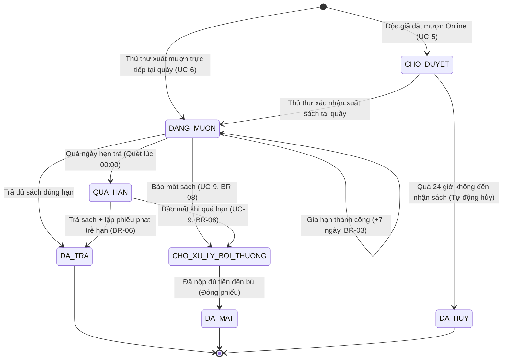
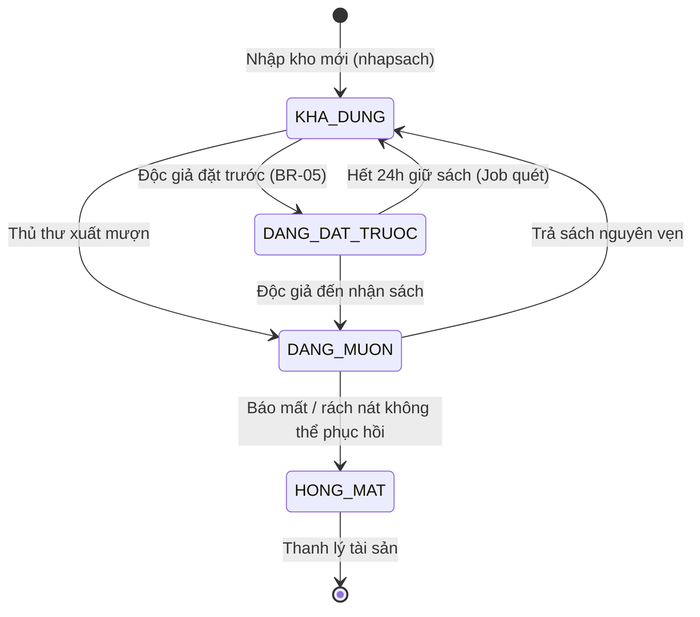
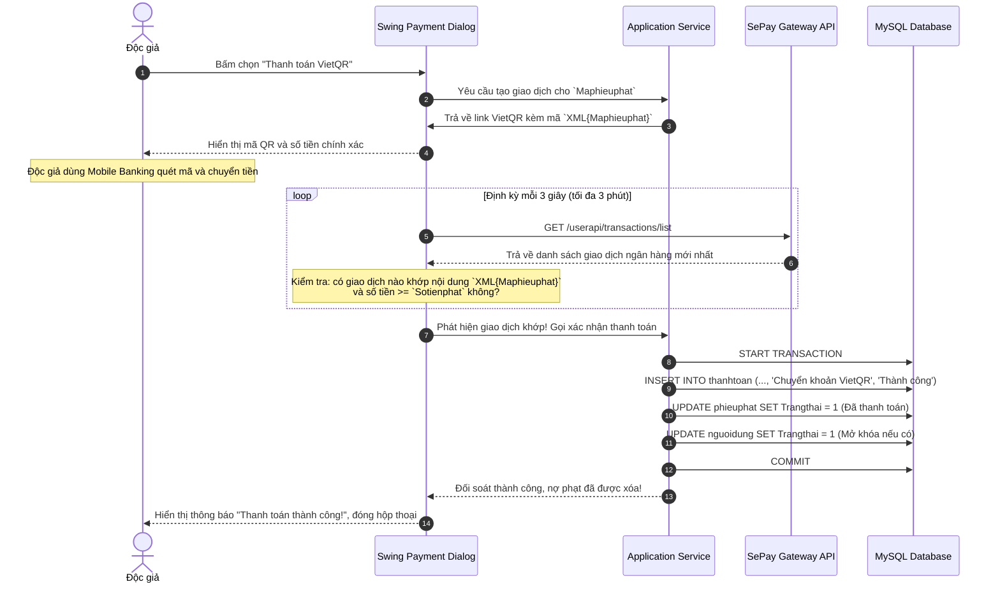

# Version: 1.1 | Last updated: 2026-10-27 | Owner: Architecture Team | Related files: ../AGENTS.md, ARCHITECTURE.md, DATABASE_SCHEMA.md, PROJECT_STATUS.md

# BUSINESS_RULES.md — Quy tắc Nghiệp vụ & Máy Trạng thái XimiLib

## 1. Máy Trạng thái Hữu hạn (Finite State Machines - FSM)

### 1.1 FSM Phiếu Mượn (`phieumuon`) (C1, C2, C3)
Mỗi phiếu mượn đại diện cho một giao dịch mượn sách của độc giả và chuyển đổi trạng thái theo chuẩn SRS UC-5, UC-6 và UC-9:



#### Bảng Chuyển trạng thái Phiếu mượn:
| Trạng thái nguồn | Sự kiện kích hoạt | Điều kiện kiểm tra (Guard) | Trạng thái đích | Hành động kèm theo |
|---|---|---|---|---|
| `[*]` | Đặt mượn Online | Độc giả thỏa mãn V-01..V-05 | `0` (`CHO_DUYET`) | Khóa bi quan 1 cuốn `KHA_DUNG` $
ightarrow$ `DANG_DAT_TRUOC` (giữ 24h). |
| `[*]` | Mượn tại quầy | Độc giả thỏa mãn V-01..V-05 | `1` (`DANG_MUON`) | Quét mã vạch, chuyển cuốn sang `DANG_MUON`, hạn 14 ngày (`VE_NHA`) hoặc 17:00 (`TAI_CHO`). |
| `0` (`CHO_DUYET`) | Xuất sách tại quầy | Độc giả trình thẻ nhận sách trong 24h | `1` (`DANG_MUON`) | Cuốn chuyển `DANG_MUON`, gửi `thongbao` xác nhận. |
| `0` (`CHO_DUYET`) | Quá hạn 24 giờ | Quá thời điểm `Hantranhan` | `6` (`DA_HUY`) | Background job tự hủy phiếu, chuyển cuốn về lại `KHA_DUNG`. |
| `1` (`DANG_MUON`) | Yêu cầu gia hạn | Chưa gia hạn lần nào & không ai đặt trước | `1` (`DANG_MUON`) | Tăng ngày hẹn trả thêm 7 ngày (BR-03), lưu `giahanmuon`. |
| `1` (`DANG_MUON`) | Quét quá hạn | `CURRENT_DATE > Ngaytra` | `3` (`QUA_HAN`) | Đánh dấu quá hạn, gửi thông báo nhắc nhở tới độc giả. |
| `1` (`DANG_MUON`) | Trả sách | Trả đủ số lượng sách, nguyên vẹn | `2` (`DA_TRA`) | Chuyển cuốn sách về `KHA_DUNG`, đóng phiếu mượn. |
| `3` (`QUA_HAN`) | Trả sách trễ | Độc giả mang trả sách | `2` (`DA_TRA`) | Tính tiền phạt BR-06 (2.000đ/ngày), tạo bản ghi `phieuphat`, chuyển sách về `KHA_DUNG`. |
| `1` hoặc `3` | Báo mất sách | Độc giả/thủ thư báo mất sách (UC-9) | `4` (`CHO_XU_LY_BOI_THUONG`) | Chuyển cuốn sang `HONG_MAT`, tính đền bù theo BR-08, lập `phieuphat` lý do "Mất sách". **Phiếu mượn chưa đóng!** |
| `4` | Nộp tiền đền bù | Độc giả nộp phạt tiền mặt / VietQR | `5` (`DA_MAT`) | Ghi nhận `thanhtoan`, cập nhật `phieuphat` thành Đã nộp, **chính thức đóng phiếu mượn**. |

---

### 1.2 FSM Cuốn Sách Vật lý (`cuonsach`)
Trạng thái cuốn sách phản ánh tính khả dụng lưu thông trong kho thư viện:



#### Bảng Chuyển trạng thái Cuốn sách:
| Trạng thái nguồn | Sự kiện kích hoạt | Điều kiện kiểm tra (Guard) | Trạng thái đích | Hành động kèm theo |
|---|---|---|---|---|
| `[*]` | Nhập lô sách mới | Nghiệm thu phiếu nhập thành công | `KHA_DUNG` | Gán mã vạch `Macuonsach`, xếp vào vị trí `Makesach`. |
| `KHA_DUNG` | Mượn sách | Độc giả hợp lệ theo quy chế | `DANG_MUON` | Khóa bi quan `SELECT ... FOR UPDATE`, cập nhật `updated_at`. |
| `KHA_DUNG` | Đặt giữ sách | Độc giả đặt trên app, sách sẵn sàng | `DANG_DAT_TRUOC` | Đặt hạn giữ 24h, ghi nhận thứ tự ưu tiên `datcho`. |
| `DANG_DAT_TRUOC` | Nhận sách đặt | Đến quầy trong vòng 24h | `DANG_MUON` | Chuyển trạng thái `datcho` sang `2` (`Da nhan`). |
| `DANG_DAT_TRUOC` | Quá hạn 24h | Hết 24h không đến nhận | `KHA_DUNG` | Hủy lượt `datcho`, chuyển quyền cho người kế tiếp (nếu có). |
| `DANG_MUON` | Trả sách | Sách còn nguyên vẹn | `KHA_DUNG` | Cập nhật `Tinhtrangkhitra`, đưa về kệ sách lưu trữ. |
| `DANG_MUON` | Báo mất/hỏng nặng | Xác nhận mất mát hoặc rách hỏng | `HONG_MAT` | Loại khỏi danh mục lưu thông, tạo phiếu bồi thường. |

---

## 2. Công thức Tài chính & Phạt (Financial Formulas)

### 2.1 Công thức Phạt Quá hạn (BR-06)
- **Đơn giá:** `2.000 VNĐ / ngày trễ / cuốn sách`.
- **Cách tính ngày trễ:** Làm tròn theo mốc `00:00` ngày dương lịch.
  $$\text{Số ngày trễ} = \max\left(0, \text{ChronoUnit.DAYS.between}(\text{Ngaytra}, \text{NgayThucTra})\right)$$
- **Tổng tiền phạt quá hạn:**
  $$\text{TienPhatQuaHan} = \text{Số ngày trễ} \times 2.000 \times \text{Số cuốn quá hạn}$$

### 2.2 Công thức Bồi thường Mất hoặc Hỏng Sách (BR-08)
Khi một cuốn sách bị mất hoặc hư hỏng không thể phục hồi, phiếu mượn được đóng (`DA_TRA`) và hệ thống lập một phiếu phạt/đền bù riêng theo công thức:

$$\text{TienBoiThuong} = (200\% \times \text{Giabia}) + \text{PhiKyThuat} + (\text{Số ngày trễ} \times 2.000)$$

Trong đó:
- `Giabia`: Giá bìa niêm yết trong bảng `sach` (kiểu `DECIMAL(12,2)`).
- `PhiKyThuat`: Phí cố định xử lý biên mục và đóng mã là `20.000 VNĐ`.
- `Số ngày trễ`: Tính từ hạn trả đến ngày độc giả chính thức báo mất.

#### 3 Ví dụ Số Cụ thể:
1. **Ví dụ 1 (Mất sách trong hạn):**
   - Sách "Lập trình Java căn bản", Giá bìa = `80.000 VNĐ`. Báo mất khi còn hạn trả (Số ngày trễ = 0).
   - $\text{Tiền bồi thường} = (2.0 \times 80.000) + 20.000 + 0 = \mathbf{180.000\text{ VNĐ}}$.
2. **Ví dụ 2 (Mất sách khi đã trễ 5 ngày):**
   - Sách "Cấu trúc dữ liệu và giải thuật", Giá bìa = `100.000 VNĐ`. Báo mất sau khi trễ hạn 5 ngày.
   - $\text{Tiền phạt trễ} = 5 \times 2.000 = 10.000\text{ VNĐ}$.
   - $\text{Tiền bồi thường} = (2.0 \times 100.000) + 20.000 + 10.000 = \mathbf{230.000\text{ VNĐ}}$.
3. **Ví dụ 3 (Sách hỏng bìa/rách nhẹ phục hồi được):**
   - Độc giả làm bung gáy hoặc rách trang nhẹ nhưng phục hồi được. Không áp dụng công thức mất sách 200%.
   - Thu đúng mức phí kỹ thuật phục chế: $\text{PhiKyThuat} = \mathbf{20.000\text{ VNĐ}}$ (+ tiền phạt trễ hạn nếu có).

---

## 3. Quy trình Đối soát Thanh toán VietQR SePay (Reconciliation Logic)
Khi độc giả thanh toán tiền phạt qua cổng VietQR, hệ thống thực hiện đối soát tự động:



### Pseudocode Đối soát SePay:
```java
public boolean reconcileFinePayment(String fineTicketId, BigDecimal expectedAmount) {
    String paymentCode = "XML" + fineTicketId;
    List<SePayTransaction> transactions = sePayClient.getRecentTransactions();

    for (SePayTransaction tx : transactions) {
        if (tx.getContent() != null && tx.getContent().contains(paymentCode)) {
            if (tx.getAmount().compareTo(expectedAmount) >= 0) {
                // Khớp mã và số tiền: Thực hiện cập nhật Database có Transaction
                paymentService.completeFinePayment(fineTicketId, tx.getTransactionId(), tx.getAmount(), "Chuyển khoản VietQR");
                return true;
            }
        }
    }
    return false;
}
```

---

## 4. Ma trận Kiểm tra Hợp lệ khi Mượn Sách (Validation Matrix)
Trước khi thủ thư hoặc hệ thống tạo phiếu mượn, toàn bộ 5 điều kiện sau bắt buộc phải vượt qua:

| STT | Tiêu chí kiểm tra | Điều kiện hợp lệ | Mã ngoại lệ khi vi phạm | Hành động xử lý |
|---|---|---|---|---|
| **V-01** | Trạng thái thẻ thư viện | `thethuvien.Trangthai = 1` VÀ `Ngayhethan >= CURRENT_DATE` | `CardExpiredException` (`LOAN_003`) | Từ chối mượn; yêu cầu độc giả làm thủ tục gia hạn thẻ. |
| **V-02** | Dư nợ tiền phạt | Không có bản ghi `phieuphat` nào có `Trangthai = 0` | `UnpaidFineException` (`LOAN_002`) | Chặn tạo phiếu; điều hướng sang thanh toán tiền phạt. |
| **V-03** | Hạn mức số lượng mượn | $\text{Số sách đang mượn} + \text{Số sách mượn mới} \le 3$ | `BorrowLimitExceededException` (`LOAN_001`) | Cảnh báo quá giới hạn 3 cuốn (BR-02). |
| **V-04** | Trạng thái cuốn sách | `cuonsach.Trangthaisach = 'KHA_DUNG'` | `BookNotAvailableException` | Khóa bi quan phát hiện sách đang được mượn/hỏng. |
| **V-05** | Ưu tiên hàng đợi đặt chỗ | Cuốn sách không bị người khác giữ chỗ trong 24h | `ReservedBookException` | Nếu có hàng đợi `datcho`, chỉ độc giả đứng đầu FIFO mới được mượn. |

---

## 5. Danh mục Chi tiết 9 Quy tắc Nghiệp vụ (BR-01 đến BR-09)

### `BR-01`: Khóa Đăng nhập Tạm thời
- Nhập sai mật khẩu liên tiếp **5 lần** sẽ tự động khóa tài khoản trong **15 phút**.
- Bộ đếm số lần sai được lưu tập trung trong DB (`solansai`, `khoaden`). Khóa có hiệu lực trên toàn bộ các máy trong mạng LAN.
- Khi người dùng nhập đúng mật khẩu, bộ đếm số lần sai lập tức được reset về `0`.

### `BR-02`: Hạn mức Mượn Về Nhà
- Mỗi độc giả chỉ được mượn tối đa **3 cuốn sách** cùng lúc.
- Thời hạn mượn chuẩn là **14 ngày** tính từ ngày lập phiếu.

### `BR-03`: Quy định Gia hạn Mượn
- Mỗi phiếu mượn chỉ được phép gia hạn tối đa **1 lần**.
- Thời gian gia hạn cộng thêm đúng **7 ngày** vào hạn trả cũ.
- Điều kiện: Phiếu mượn chưa bị quá hạn VÀ đầu sách đó không có độc giả nào khác đang đặt trước (`datcho`).

### `BR-04`: Mượn Đọc Tại chỗ
- Sách mượn đọc tại chỗ bắt buộc phải hoàn trả trước **17:00 cùng ngày**.
- Nếu độc giả không trả sách trước 17:00, hệ thống chuyển sang trạng thái quá hạn và áp dụng mức phạt như mượn về nhà theo `BR-06`.

### `BR-05`: Đặt trước Đầu sách (Hold / Reservation)
- Khi một đầu sách hết cuốn khả dụng, độc giả được đặt trước tối đa **1 đầu sách**.
- Khi có sách trả về, hệ thống phân bổ theo nguyên tắc **FIFO** (Ai đặt trước nhận trước) và đổi trạng thái cuốn sách sang `DANG_DAT_TRUOC`.
- Thời gian giữ sách tối đa là **24 giờ**. Hết 24h nếu độc giả không đến mượn, batch job tự động hủy lượt đặt và chuyển sách về `KHA_DUNG` (hoặc chuyển cho người kế tiếp).

### `BR-06`: Phạt Quá hạn
- Mức phí phạt: **2.000 VNĐ / ngày trễ / mỗi cuốn sách**.
- Thời gian trễ tính theo số ngày dương lịch (mốc `00:00` hàng ngày). Không giới hạn trần phạt, tính lũy kế đến ngày thực trả.

### `BR-07`: Chặn Giao dịch khi Vi phạm
- Hệ thống từ chối mọi yêu cầu mượn sách mới hoặc gia hạn nếu:
  1. Thẻ thư viện đã quá ngày hết hạn (`Ngayhethan < CURRENT_DATE`).
  2. Độc giả còn bất kỳ khoản nợ phạt nào chưa thanh toán (`phieuphat.Trangthai = 0`).

### `BR-08`: Bồi thường Mất hoặc Hỏng Sách
- Khi sách bị mất hoặc hư hỏng hoàn toàn: Đóng phiếu mượn (`DA_TRA`), chuyển trạng thái cuốn sách sang `HONG_MAT`, đồng thời lập phiếu phạt bồi thường độc lập:
  $$\text{Số tiền} = 200\% \times \text{Giá bìa} + 20.000\text{ VNĐ (Phí biên mục)} + \text{Phạt trễ hạn (nếu có)}$$
- Tiền phạt trễ hạn ngừng tính kể từ thời điểm độc giả thông báo mất sách cho thủ thư.

### `BR-09`: Xóa Sách An toàn (Soft-Delete)
- Đầu sách xóa khỏi hệ thống chỉ được đánh dấu cờ xóa mềm (`IsDeleted = TRUE` hoặc `trangthai = 'DA_XOA'`).
- Tuyệt đối cấm xóa đầu sách nếu vẫn còn cuốn sách vật lý đang trong trạng thái `DANG_MUON` hoặc đang có phiếu mượn chưa đóng.

---

## 6. Open Issues (Vấn đề Mở)
- `[OPEN-BR-01]`: Xử lý ngày nghỉ lễ/Tết khi tính phạt quá hạn: Hiện tại BR-06 tính phạt theo ngày dương lịch cố định bao gồm cả thứ Bảy, Chủ nhật. Cần văn bản phê duyệt của Nhà trường nếu muốn áp dụng chính sách miễn trừ ngày nghỉ lễ.
- `[OPEN-BR-02]`: Cơ chế thông báo nhắc hạn tự động qua Zalo ZNS/SMS: Do hiện tại xếp loại `[Nice/Future Scope]`, hệ thống tạm thời chỉ sinh bản ghi thông báo trong bảng `thongbao` để hiển thị trên giao diện chuông thông báo của độc giả.
