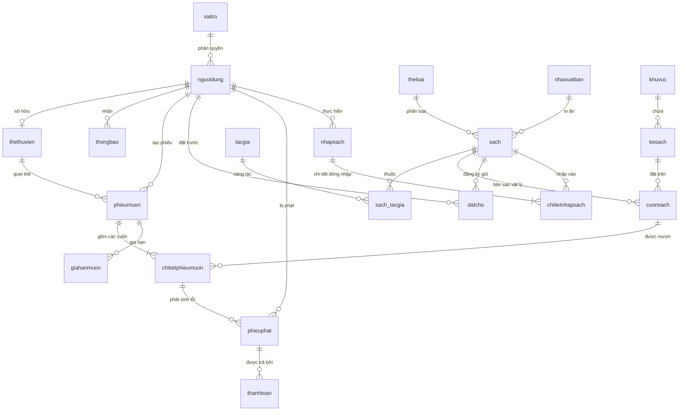

# Version: 1.1 | Last updated: 2026-10-27 | Owner: Architecture Team | Related files: ../AGENTS.md, ARCHITECTURE.md, BUSINESS_RULES.md, PROJECT_STATUS.md

# DATABASE_SCHEMA.md — Đặc tả Cơ sở Dữ liệu XimiLib (MySQL 8.0+)

## 1. Quy ước Chung
- **Hệ quản trị CSDL:** MySQL 8.0+, Storage Engine bắt buộc là `InnoDB` đảm bảo toàn vẹn giao dịch ACID.
- **Bảng mã (Charset & Collation):** `utf8mb4` kết hợp `utf8mb4_unicode_ci` hỗ trợ đầy đủ tiếng Việt có dấu.
- **Kiểu dữ liệu chuẩn:**
  - Tiền tệ: `DECIMAL(12,2)` cho giá bìa, tiền phạt; `DECIMAL(14,2)` cho tổng tiền phiếu nhập. Cấm dùng `FLOAT`/`DOUBLE`.
  - Ngày giờ: `DATETIME` cho thời điểm phát sinh sự kiện/giao dịch; `DATE` cho ngày sinh, ngày cấp/hạn thẻ.
  - Khóa chính định danh: `VARCHAR(50)` sinh tự động có tiền tố theo nghiệp vụ (VD: `ND...`, `PM...`, `CS...`).
- **Quy tắc đặt tên:**
  - Tên bảng: Chữ thường không dấu viết liền (`nguoidung`, `thethuvien`, `chitietphieumuon`).
  - Tên cột: Viết hoa chữ cái đầu hoặc camelCase theo DDL gốc (`ID`, `Masach`, `Tensach`, `IsDeleted`).
  - Khóa ngoại: `fk_<bảng_con>_<bảng_cha>`.
  - Chỉ mục (Index): `idx_<bảng>_<cột>`.
- **Cột Audit & Đồng bộ chuẩn:** Bảng `cuonsach` bổ sung cột `updated_at TIMESTAMP DEFAULT CURRENT_TIMESTAMP ON UPDATE CURRENT_TIMESTAMP` phục vụ đồng bộ Observer đa máy.

## 2. Ma trận 6 Phân hệ × 20 Bảng
| STT | Phân hệ (Module) | Tên bảng (Table) | Mô tả tóm tắt nghiệp vụ |
|---|---|---|---|
| 1 | **Phân quyền & Người dùng** | `vaitro` | Danh mục vai trò trong hệ thống (ADMIN, LIBRARIAN, READER). |
| 2 | | `nguoidung` | Tài khoản, mật khẩu băm BCrypt và thông tin cá nhân. |
| 3 | | `thethuvien` | Thẻ thư viện liên kết 1-1 với tài khoản độc giả. |
| 4 | | `thongbao` | Hộp thư thông báo nhắc hạn, quá hạn và phạt cho độc giả. |
| 5 | **Danh mục Sách** | `theloai` | Danh mục thể loại sách (Khoa học, Văn học, Công nghệ,...). |
| 6 | | `tacgia` | Thông tin tiểu sử các tác giả. |
| 7 | | `nhaxuatban` | Thông tin liên hệ các Nhà xuất bản. |
| 8 | | `sach` | Thông tin đầu sách (tên, ISBN, giá bìa, soft-delete). |
| 9 | | `sach_tacgia` | Bảng quan hệ Nhiều - Nhiều giữa đầu sách và tác giả. |
| 10 | **Kho & Vị trí** | `khuvuc` | Phân khu trong thư viện (Tầng 1, Khu Tự nhiên, Khu Xã hội). |
| 11 | | `kesach` | Kệ sách đặt tại từng khu vực cụ thể. |
| 12 | | `cuonsach` | Từng cuốn sách vật lý cụ thể (mã vạch, tình trạng, vị trí kệ). |
| 13 | **Mượn trả & Đặt chỗ** | `phieumuon` | Phiếu mượn sách tổng hợp theo đợt của độc giả. |
| 14 | | `chitietphieumuon` | Chi tiết từng cuốn sách mượn, ngày trả thực tế và tiền phạt. |
| 15 | | `giahanmuon` | Lịch sử yêu cầu gia hạn thời gian mượn sách (tối đa 1 lần). |
| 16 | | `datcho` | Hàng đợi đặt trước đầu sách khi thư viện tạm hết sách sẵn có. |
| 17 | **Phạt & Thanh toán** | `phieuphat` | Bản ghi ghi nhận vi phạm trễ hạn hoặc bồi thường mất/hỏng. |
| 18 | | `thanhtoan` | Lịch sử thanh toán phạt tiền mặt hoặc chuyển khoản VietQR. |
| 19 | **Nhập sách (Kho)** | `nhapsach` | Phiếu nhập lô sách mới từ Nhà cung cấp do thủ thư lập. |
| 20 | | `chitietnhapsach` | Chi tiết số lượng và đơn giá nhập từng đầu sách. |

## 3. Sơ đồ Thực thể Liên kết (Mermaid ERD)


## 4. Từ điển Dữ liệu Chi tiết (Data Dictionary 20 Bảng)

### 4.1 Phân hệ 1: Phân quyền & Người dùng
- **`vaitro`**:
  - `Mavaitro` (`VARCHAR(50)`, PK, NOT NULL): Mã vai trò (`ADMIN`, `LIBRARIAN`, `READER`).
  - `Tenvaitro` (`NVARCHAR(50)`, NOT NULL): Tên hiển thị vai trò.
  - `Mota` (`TEXT`, NULL): Mô tả thẩm quyền.
- **`nguoidung`**:
  - `ID` (`VARCHAR(50)`, PK, NOT NULL): Mã người dùng duy nhất.
  - `Tendangnhap` (`VARCHAR(50)`, UNIQUE, NOT NULL): Tên đăng nhập.
  - `Matkhau` (`VARCHAR(255)`, NOT NULL): Mật khẩu băm an toàn BCrypt.
  - `Hoten` (`NVARCHAR(100)`, NOT NULL): Họ và tên đầy đủ.
  - `Email` (`VARCHAR(100)`, UNIQUE, NULL): Địa chỉ email liên hệ.
  - `Gioitinh` (`BOOLEAN`, NULL): Giới tính (1: Nam, 0: Nữ).
  - `Sdt` (`VARCHAR(20)`, NULL): Số điện thoại liên hệ.
  - `Mavaitro` (`VARCHAR(50)`, FK → `vaitro.Mavaitro`, NOT NULL).
  - `Trangthai` (`INT`, NOT NULL, DEFAULT 1): Trạng thái tài khoản (1: Hoạt động, 0: Khóa).
- **`thethuvien`**:
  - `Mathe` (`VARCHAR(50)`, PK, NOT NULL): Số thẻ thư viện vật lý/điện tử.
  - `ID` (`VARCHAR(50)`, FK → `nguoidung.ID`, NOT NULL): Mã độc giả sở hữu.
  - `Ngaycap` (`DATE`, NOT NULL): Ngày phát hành thẻ.
  - `Ngayhethan` (`DATE`, NOT NULL): Ngày hết hạn thẻ (BR-07 kiểm tra).
  - `Trangthai` (`INT`, NOT NULL, DEFAULT 1): Trạng thái thẻ (1: Hoạt động, 0: Khóa/Hết hạn).
- **`thongbao`**:
  - `Mathongbao` (`VARCHAR(50)`, PK, NOT NULL): Mã thông báo.
  - `ID` (`VARCHAR(50)`, FK → `nguoidung.ID`, NOT NULL): Người nhận.
  - `Tieude` (`NVARCHAR(255)`, NOT NULL): Tiêu đề thông báo.
  - `Noidung` (`TEXT`, NOT NULL): Nội dung chi tiết.
  - `Loaithongbao` (`NVARCHAR(50)`, DEFAULT 'Hệ thống'): Loại (Nhắc hạn, Phạt, Hệ thống).
  - `Ngaytao` (`DATETIME`, NOT NULL): Thời gian gửi.
  - `Dadoc` (`INT`, NOT NULL, DEFAULT 0): Đánh dấu đã đọc (0: Chưa đọc, 1: Đã đọc).

### 4.2 Phân hệ 2: Danh mục Sách & Tác giả
- **`theloai`**:
  - `Matheloai` (`INT`, PK, AUTO_INCREMENT): Mã số thể loại sách.
  - `Tentheloai` (`NVARCHAR(100)`, NOT NULL): Tên thể loại.
  - `Mota` (`NVARCHAR(255)`, NULL): Mô tả chi tiết.
- **`tacgia`**:
  - `Matacgia` (`VARCHAR(50)`, PK, NOT NULL): Mã định danh tác giả.
  - `Tentacgia` (`NVARCHAR(100)`, NOT NULL): Tên tác giả.
  - `Mota` (`TEXT`, NULL): Tóm lược tiểu sử.
- **`nhaxuatban`**:
  - `manxb` (`VARCHAR(50)`, PK, NOT NULL): Mã nhà xuất bản.
  - `tennxb` (`NVARCHAR(100)`, NOT NULL): Tên nhà xuất bản.
  - `diachinxb` (`NVARCHAR(255)`, NULL): Địa chỉ trụ sở.
  - `sdt` (`VARCHAR(20)`, NULL): Số điện thoại liên hệ.
  - `mota` (`TEXT`, NULL): Ghi chú bổ sung.
- **`sach`**:
  - `Masach` (`VARCHAR(50)`, PK, NOT NULL): Mã đầu sách.
  - `Matheloai` (`INT`, FK → `theloai.Matheloai`, NULL): Khóa ngoại thể loại.
  - `Manxb` (`VARCHAR(50)`, FK → `nhaxuatban.manxb`, NULL): Khóa ngoại NXB.
  - `Tensach` (`NVARCHAR(255)`, NOT NULL): Tiêu đề sách (có index).
  - `Isbn` (`VARCHAR(100)`, NULL): Mã ISBN chuẩn quốc tế (có index).
  - `Namxb` (`INT`, NULL): Năm xuất bản.
  - `Sotrang` (`INT`, NULL): Số trang của sách.
  - `Giabia` (`DECIMAL(12,2)`, NOT NULL, DEFAULT 0.00): Giá bìa niêm yết (cơ sở tính BR-08).
  - `Motasach` (`TEXT`, NULL): Tóm tắt nội dung.
  - `Hinhanh` (`VARCHAR(255)`, NULL): Đường dẫn tương đối của ảnh bìa trong thư mục tài nguyên.
  - `IsDeleted` (`BOOLEAN`, NOT NULL, DEFAULT FALSE): Đánh dấu xóa mềm (Soft-delete).
- **`sach_tacgia`**:
  - `Masach` (`VARCHAR(50)`, PK, FK → `sach.Masach`): Mã đầu sách.
  - `Matacgia` (`VARCHAR(50)`, PK, FK → `tacgia.Matacgia`): Mã tác giả.
  - `Vaitrotacgia` (`NVARCHAR(50)`, DEFAULT 'Tác giả chính'): Vai trò (Đồng tác giả, Dịch giả).

### 4.3 Phân hệ 3: Kho & Vị trí Kệ sách
- **`khuvuc`**:
  - `Makhuvuc` (`VARCHAR(50)`, PK, NOT NULL): Mã khu vực.
  - `Tenkhuvuc` (`NVARCHAR(100)`, NOT NULL): Tên phòng/khu (Tầng 1, Khu Khoa học Tự nhiên).
  - `Motakhuvuc` (`NVARCHAR(255)`, NULL): Ghi chú vị trí.
- **`kesach`**:
  - `Makesach` (`VARCHAR(50)`, PK, NOT NULL): Mã định danh kệ sách.
  - `Makhuvuc` (`VARCHAR(50)`, FK → `khuvuc.Makhuvuc`, NOT NULL): Thuộc khu vực.
  - `Tenkesach` (`NVARCHAR(100)`, NOT NULL): Tên kệ hiển thị.
  - `Tang` (`INT`, NOT NULL, DEFAULT 1): Số thứ tự tầng trên kệ.
  - `Motake` (`NVARCHAR(255)`, NULL): Mô tả chi tiết.
- **`cuonsach`**:
  - `Macuonsach` (`VARCHAR(50)`, PK, NOT NULL): Mã vạch/mã số từng cuốn sách vật lý.
  - `Masach` (`VARCHAR(50)`, FK → `sach.Masach`, NOT NULL): Thuộc đầu sách nào.
  - `Makesach` (`VARCHAR(50)`, FK → `kesach.Makesach`, NULL): Kệ sách lưu trữ hiện tại.
  - `Isbn` (`VARCHAR(50)`, NULL): Mã phụ trợ.
  - `Ngaynhap` (`DATE`, NULL): Ngày nhập kho vật lý.
  - `Tinhtrangsach` (`NVARCHAR(50)`, DEFAULT 'Mới'): Trạng thái vật lý (`Moi`, `Tot`, `Cu`, `Hong`).
  - `Trangthaisach` (`NVARCHAR(50)`, NOT NULL, DEFAULT 'KHA_DUNG'): Trạng thái mượn (`KHA_DUNG`, `DANG_MUON`, `DANG_DAT_TRUOC`, `HONG_MAT`).
  - `updated_at` (`TIMESTAMP`, DEFAULT CURRENT_TIMESTAMP ON UPDATE CURRENT_TIMESTAMP): Phục vụ đồng bộ đa máy.

### 4.4 Phân hệ 4: Mượn trả & Đặt chỗ
- **`phieumuon`**:
  - `Maphieumuon` (`VARCHAR(50)`, PK, NOT NULL): Mã phiếu mượn.
  - `ID` (`VARCHAR(50)`, FK → `nguoidung.ID`, NOT NULL): Độc giả mượn.
  - `Mathe` (`VARCHAR(50)`, FK → `thethuvien.Mathe`, NOT NULL): Thẻ thư viện sử dụng.
  - `Ngaymuon` (`DATE`, NOT NULL): Ngày lập phiếu mượn.
  - `Ngaytra` (`DATE`, NULL): Hạn trả dự kiến toàn phiếu (14 ngày đối với mượn về nhà).
  - `Trangthai` (`INT`, NOT NULL, DEFAULT 1): Trạng thái phiếu (1: Đang mượn, 2: Đã trả, 3: Quá hạn).
  - `Ghichuphieu` (`NVARCHAR(255)`, NULL): Ghi chú thủ thư.
- **`chitietphieumuon`**:
  - `Machitiet` (`VARCHAR(50)`, PK, NOT NULL): Mã dòng chi tiết.
  - `Maphieumuon` (`VARCHAR(50)`, FK → `phieumuon.Maphieumuon`, NOT NULL): Khóa ngoại phiếu mượn.
  - `Macuonsach` (`VARCHAR(50)`, FK → `cuonsach.Macuonsach`, NOT NULL): Cuốn sách mượn.
  - `Ngaytra` (`DATETIME`, NULL): Ngày giờ thực tế trả cuốn sách.
  - `Tinhtrangkhimuon` (`NVARCHAR(100)`, NULL): Hiện trạng cuốn sách lúc giao độc giả.
  - `Tinhtrangkhitra` (`NVARCHAR(100)`, NULL): Hiện trạng cuốn sách lúc nhận lại.
  - `Tienphat` (`DECIMAL(12,2)`, NOT NULL, DEFAULT 0.00): Tiền phạt quá hạn riêng của cuốn này.
- **`giahanmuon`**:
  - `Magiahan` (`VARCHAR(50)`, PK, NOT NULL): Mã bản ghi gia hạn.
  - `Maphieumuon` (`VARCHAR(50)`, FK → `phieumuon.Maphieumuon`, NOT NULL): Phiếu mượn được gia hạn.
  - `Ngaygiahan` (`DATETIME`, NOT NULL): Thời điểm thực hiện yêu cầu gia hạn.
  - `Hantracu` (`DATETIME`, NOT NULL): Hạn trả trước khi gia hạn.
  - `Hantramoi` (`DATETIME`, NOT NULL): Hạn trả mới sau gia hạn (+7 ngày theo BR-03).
  - `Lydogiahan` (`NVARCHAR(255)`, NULL): Lý do xin gia hạn.
  - `Trangthai` (`INT`, NOT NULL, DEFAULT 1): Kết quả duyệt (1: Chấp thuận, 0: Từ chối).
- **`datcho`**:
  - `Madatcho` (`VARCHAR(50)`, PK, NOT NULL): Mã yêu cầu đặt chỗ/giữ sách.
  - `ID` (`VARCHAR(50)`, FK → `nguoidung.ID`, NOT NULL): Độc giả đặt sách.
  - `Masach` (`VARCHAR(50)`, FK → `sach.Masach`, NOT NULL): Đầu sách muốn giữ.
  - `Ngaydat` (`DATETIME`, NOT NULL): Thời điểm nhấn đặt trước.
  - `Vitri` (`INT`, NOT NULL, DEFAULT 1): Thứ tự ưu tiên trong hàng đợi FIFO.
  - `Ngayhethan` (`DATETIME`, NOT NULL): Thời điểm hết hạn giữ (sau 24h kể từ khi sách sẵn sàng theo BR-05).
  - `Trangthai` (`INT`, NOT NULL, DEFAULT 1): 1: Đang chờ nhận, 2: Đã nhận sách, 0: Đã hủy/Hết hạn.

### 4.5 Phân hệ 5: Phạt & Thanh toán
- **`phieuphat`**:
  - `Maphieuphat` (`VARCHAR(50)`, PK, NOT NULL): Mã biên lai phạt.
  - `ID` (`VARCHAR(50)`, FK → `nguoidung.ID`, NOT NULL): Độc giả chịu phạt.
  - `Machitiet` (`VARCHAR(50)`, FK → `chitietphieumuon.Machitiet`, NULL): Chi tiết cuốn sách vi phạm.
  - `Lydophat` (`NVARCHAR(255)`, NOT NULL): Lý do (Trễ hạn, Mất sách, Hỏng bìa/trang).
  - `Sotienphat` (`DECIMAL(12,2)`, NOT NULL, DEFAULT 0.00): Tổng tiền phải nộp theo BR-06/BR-08.
  - `Ngayphat` (`DATETIME`, NOT NULL): Thời điểm phát hành phiếu phạt.
  - `Trangthai` (`INT`, NOT NULL, DEFAULT 0): Trạng thái nộp phạt (0: Chưa nộp, 1: Đã thanh toán).
  - `Ghichuphat` (`NVARCHAR(255)`, NULL): Ghi chú thủ thư.
- **`thanhtoan`**:
  - `Mathanhtoan` (`VARCHAR(50)`, PK, NOT NULL): Mã giao dịch thanh toán.
  - `Maphieuphat` (`VARCHAR(50)`, FK → `phieuphat.Maphieuphat`, NOT NULL): Khóa ngoại biên lai phạt.
  - `Ngaythanhtoan` (`DATETIME`, NOT NULL): Thời điểm hoàn tất nộp tiền.
  - `Sotien` (`DECIMAL(12,2)`, NOT NULL): Số tiền thực đóng.
  - `Phuongthuc` (`NVARCHAR(50)`, NOT NULL, DEFAULT 'Tiền mặt'): 'Tiền mặt' hoặc 'Chuyển khoản VietQR'.
  - `Trangthai` (`INT`, NOT NULL, DEFAULT 1): 1: Giao dịch thành công, 0: Thất bại.

### 4.6 Phân hệ 6: Nhập sách (Quản lý Kho)
- **`nhapsach`**:
  - `Manhapsach` (`VARCHAR(50)`, PK, NOT NULL): Mã đợt nhập hàng.
  - `ID` (`VARCHAR(50)`, FK → `nguoidung.ID`, NOT NULL): Thủ thư/Admin phụ trách tạo phiếu.
  - `Ngaynhap` (`DATETIME`, NOT NULL): Ngày giờ tiếp nhận lô sách.
  - `Nhacungcap` (`NVARCHAR(100)`, NULL): Đơn vị phân phối/Nhà sách cung cấp.
  - `Tongtien` (`DECIMAL(14,2)`, NOT NULL, DEFAULT 0.00): Tổng kinh phí đơn nhập.
  - `Ghichunhap` (`NVARCHAR(255)`, NULL): Ghi chú hóa đơn chứng từ.
- **`chitietnhapsach`**:
  - `Machitietnhap` (`VARCHAR(50)`, PK, NOT NULL): Mã dòng chi tiết nhập.
  - `Manhapsach` (`VARCHAR(50)`, FK → `nhapsach.Manhapsach`, NOT NULL): Thuộc phiếu nhập nào.
  - `Masach` (`VARCHAR(50)`, FK → `sach.Masach`, NOT NULL): Đầu sách được nhập.
  - `Soluong` (`INT`, NOT NULL, DEFAULT 1): Số lượng cuốn nhập kho.
  - `Dongia` (`DECIMAL(12,2)`, NOT NULL, DEFAULT 0.00): Giá nhập từng cuốn.
  - `Thanhtien` (`DECIMAL(14,2)`, NOT NULL, DEFAULT 0.00): Thành tiền (`Soluong` × `Dongia`).


### 4.7 Phân hệ 7: Mở Rộng Theo Đặc Tả SRS (C6: Bình luận, Góp ý, Cấu hình)
- **`binhluan`** (UC-8, F-11):
  - `id` (`INT`, PK, AUTO_INCREMENT): Mã bình luận.
  - `Masach` (`VARCHAR(50)`, FK → `sach.Masach`, NOT NULL): Đầu sách được đánh giá.
  - `id_nguoidung` (`VARCHAR(50)`, FK → `nguoidung.ID`, NOT NULL): Độc giả gửi bình luận.
  - `noidung` (`TEXT`, NOT NULL): Nội dung thảo luận.
  - `diemsao` (`INT`, NULL, DEFAULT 5): Điểm đánh giá (1 đến 5 sao).
  - `ngaytao` (`DATETIME`, NOT NULL, DEFAULT CURRENT_TIMESTAMP): Thời gian gửi.
  - `IsDeleted` (`BOOLEAN`, NOT NULL, DEFAULT FALSE): Ẩn bình luận vi phạm.
- **`gopy`** (F-10):
  - `id` (`INT`, PK, AUTO_INCREMENT): Mã góp ý.
  - `id_nguoidung` (`VARCHAR(50)`, FK → `nguoidung.ID`, NULL): Độc giả gửi (hoặc ẩn danh).
  - `tieude` (`VARCHAR(255)`, NOT NULL): Tiêu đề góp ý.
  - `noidung` (`TEXT`, NOT NULL): Nội dung phản ánh dịch vụ.
  - `ngaytao` (`DATETIME`, NOT NULL, DEFAULT CURRENT_TIMESTAMP): Thời gian gửi.
  - `trangthai` (`VARCHAR(50)`, NOT NULL, DEFAULT 'CHO_TIEP_NHAN'): Trạng thái xử lý.
- **`cauhinh`** (SRS §2.3, §3.3.4):
  - `khoa` (`VARCHAR(100)`, PK, NOT NULL): Tên tham số quy định hệ thống.
  - `giatri` (`VARCHAR(255)`, NOT NULL): Giá trị cấu hình hiện hành.
  - `mota` (`VARCHAR(255)`, NULL): Diễn giải ý nghĩa quy định.

## 5. Bảng Tra cứu Trạng thái & Enum Chuẩn (SSOT Lookup Table)
| Tên Enum / Bảng | Trường (Column) | Kiểu lưu DB | Giá trị hợp lệ | Ý nghĩa nghiệp vụ |
|---|---|---|---|---|
| `Role` | `vaitro.Mavaitro` | VARCHAR | `ADMIN`, `LIBRARIAN`, `READER` | Vai trò hệ thống. |
| `UserStatus` | `nguoidung.Trangthai` | INT | `1`: Hoạt động, `0`: Bị khóa | Trạng thái tài khoản người dùng. |
| `CardStatus` | `thethuvien.Trangthai` | INT | `1`: Hợp lệ, `0`: Hết hạn / Khóa | Tình trạng hiệu lực của thẻ thư viện. |
| `BookCopyStatus` | `cuonsach.Trangthaisach` | NVARCHAR | `KHA_DUNG`<br>`DANG_MUON`<br>`DANG_DAT_TRUOC`<br>`HONG_MAT` | Vòng đời cuốn sách vật lý. |
| `LoanTicketStatus`| `phieumuon.Trangthai` | INT | `1`: Đang mượn, `2`: Đã trả, `3`: Quá hạn | Trạng thái tiến trình mượn sách. |
| `ReservationStatus`| `datcho.Trangthai` | INT | `1`: Đang chờ nhận, `2`: Đã nhận, `0`: Đã hủy/Hết hạn | Trạng thái yêu cầu đặt giữ sách. |
| `FineStatus` | `phieuphat.Trangthai` | INT | `0`: Chưa nộp, `1`: Đã thanh toán | Trạng thái xử lý tiền phạt/bồi thường. |
| `PaymentMethod` | `thanhtoan.Phuongthuc` | NVARCHAR | `Tiền mặt`, `Chuyển khoản VietQR` | Hình thức giao dịch tài chính. |

## 6. Concurrency Control (Kiểm soát Đồng thời)
- **Kịch bản tranh chấp:** Hai độc giả A và B cùng lúc gửi yêu cầu mượn hoặc giữ cuốn sách khả dụng duy nhất còn lại của một đầu sách.
- **Giải pháp lựa chọn:** **Khóa bi quan (Pessimistic Locking)** với mệnh đề `SELECT ... FOR UPDATE` trên bảng `cuonsach`.
- **Mức cô lập (Transaction Isolation Level):** `READ COMMITTED` (Tránh phantom read kéo dài và giảm thiểu khóa dư thừa).
- **Thứ tự khóa chống Deadlock:** Bắt buộc khóa đầu sách trước theo thứ tự `Masach ASC`, sau đó khóa cuốn sách theo thứ tự `Macuonsach ASC`.

### Pseudocode Khóa Bi quan khi Mượn/Giữ sách:
```sql
-- Bắt đầu Transaction
START TRANSACTION;

-- Bước 1: Khóa bi quan tìm 1 cuốn sách đang KHA_DUNG của đầu sách 'MS001'
SELECT Macuonsach, Trangthaisach 
FROM cuonsach 
WHERE Masach = 'MS001' AND Trangthaisach = 'KHA_DUNG' 
ORDER BY Macuonsach ASC 
LIMIT 1 
FOR UPDATE;

-- Kiểm tra kết quả ở Application Service:
-- NẾU không tìm thấy bản ghi nào (hoặc đã bị transaction khác giữ):
--   ROLLBACK;
--   Ném ConcurrentHoldException("Sách vừa hết hoặc đang được người khác giữ!");
-- NẾU tìm thấy Macuonsach = 'CS010':
--   Cập nhật trạng thái cuốn sách sang 'DANG_MUON'
UPDATE cuonsach 
SET Trangthaisach = 'DANG_MUON', updated_at = NOW() 
WHERE Macuonsach = 'CS010';

--   Tạo chi tiết phiếu mượn tương ứng
INSERT INTO chitietphieumuon (Machitiet, Maphieumuon, Macuonsach, ...) 
VALUES (...);

-- Hoàn tất giao dịch an toàn
COMMIT;
```

## 7. Đề xuất Chỉ mục Tối ưu Truy vấn Nóng (Hot Query Indexes)
Để đảm bảo tốc độ phản hồi < 500ms dưới tải cao, các chỉ mục sau được thiết lập:
1. `idx_sach_search`: Bảng `sach(Tensach, Isbn, Matheloai)` hỗ trợ tìm kiếm tổ hợp siêu tốc.
2. `idx_cuonsach_status_book`: Bảng `cuonsach(Masach, Trangthaisach)` tăng tốc tối đa câu lệnh `SELECT ... FOR UPDATE` khi tìm cuốn khả dụng.
3. `idx_phieumuon_overdue`: Bảng `phieumuon(Trangthai, Ngaytra)` hỗ trợ batch job quét phiếu trễ hạn lúc 00:00.
4. `idx_datcho_expiring`: Bảng `datcho(Trangthai, Ngayhethan)` tối ưu hóa job quét tự động hủy lượt đặt trước quá 24h.
5. `idx_cuonsach_sync`: Bảng `cuonsach(updated_at)` phục vụ Observer polling scheduler quét bản ghi mới sửa đổi.

## 8. Open Issues (Vấn đề Mở)
- `[OPEN-DB-01]`: Bảng `phieumuon` có trường `Ngaytra` kiểu `DATE`, trong khi bảng `chitietphieumuon` có `Ngaytra` kiểu `DATETIME`. Cần thống nhất quy ước: `phieumuon.Ngaytra` là hạn trả hợp đồng (dueDate), còn `chitietphieumuon.Ngaytra` là thời điểm thực trả (returnedAt).
- `[OPEN-DB-02]`: Bảng `thethuvien` hiện đang dùng `Mathe` làm PK dạng `VARCHAR(50)`. Cần đảm bảo hệ thống sinh chuỗi mã thẻ có định dạng chuẩn (ví dụ `LIB-YYYY-XXXXX`) để dễ in mã vạch/thẻ vật lý.
