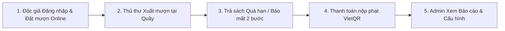

# HƯỚNG DẪN DEMO & BỘ CÂU HỎI VẤN ĐÁP BẢO VỆ XIMILIB

> **Tài liệu phục vụ buổi Demo & Vấn đáp hệ thống**  
> Hệ thống: **XimiLib - Desktop Library Management System (Thư viện làng Xì Mi)**  
> Kiến trúc: **Clean Architecture (Java 25 + FlatLaf Swing + MySQL Pure JDBC)**

---

# PHẦN 1: KỊCH BẢN DẪN DẮT DEMO (8 – 10 PHÚT)

> **Chiến thuật:** Dẫn dắt giảng viên theo **1 câu chuyện liền mạch** xuyên suốt vòng đời cuốn sách và độc giả. Không click chuột vu vơ từng tab.

### Bước 0: Chuẩn bị máy trước khi lên bảo vệ (5 phút trước giờ G)
1. **IDE:** Mở sẵn các file cốt lõi:
   - `sources\src\main\java\com\ximilib\application\service\impl\CirculationServiceImpl.java` (Logic mượn trả, transaction, khóa bi quan).
   - `sources\src\main\java\com\ximilib\domain\model\LibraryPolicy.java` (Công thức phạt, hạn mức).
2. **Database GUI (DBeaver / MySQL Workbench):** Mở sẵn truy vấn kiểm tra các bảng: `cuonsach`, `phieumuon`, `phieuphat`, `auditlog`.
3. **Chạy ứng dụng:** Chạy sẵn `sources\src\main\java\com\ximilib\Main.java` hoặc file `dist\XimiLib.jar`, dừng ở màn hình Đăng nhập.

---

### Chặng 1: Mở màn – Bảo mật & Giao diện Độc giả (2 phút)
- **Thao tác 1 (Bảo mật tài khoản):**
  - Nhập sai mật khẩu 1 lần để biểu diễn thông báo đếm số lần sai (BR-01).
  - Đăng nhập vào tài khoản **Độc giả**.
- **Lời thoại:**
  > *"Kính thưa quý thầy cô, hệ thống XimiLib được phân quyền chặt chẽ theo 3 vai trò: Độc giả, Thủ thư và Quản trị viên (Admin). Mật khẩu người dùng được băm bảo mật bằng BCrypt với salt ngẫu nhiên, số CCCD được mã hóa đối xứng AES-256. Để chống tấn công dò mật khẩu (Brute-force), nếu nhập sai liên tiếp 5 lần hệ thống sẽ tự động khóa tài khoản 15 phút trên toàn bộ các máy trạm trong mạng LAN."*
- **Thao tác 2 (Tra cứu & Đặt mượn Online):**
  - Mở `BookCatalogView`, gõ tìm kiếm sách, lọc theo thể loại. Mở chi tiết xem số lượng cuốn khả dụng, vị trí Khu vực - Kệ sách và phần Bình luận/Đánh giá.
  - Bấm mở **Thẻ thư viện số (QR Code)** ở góc trên (sử dụng `GlassPanePopup`).
  - Chuyển sang tab Đặt mượn Online (`ReaderBorrowRegistrationView`), bấm chọn đặt mượn 1 cuốn sách.
- **Lời thoại:**
  > *"Khi độc giả đặt mượn online, hệ thống lập tức kiểm tra 6 điều kiện hợp lệ (thẻ còn hạn, không nợ phạt, không giữ quá 3 cuốn...). Sau đó, hệ thống dùng khóa bi quan `SELECT ... FOR UPDATE` chuyển 1 cuốn sách sang trạng thái `DANG_DAT_TRUOC` và giữ chỗ độc quyền trong 24 giờ. Quá 24 giờ nếu không đến quầy nhận, hệ thống tự động hủy phiếu và trả sách về khả dụng."*

---

### Chặng 2: Nghiệp vụ Thủ thư, Bồi thường mất sách & VietQR (4 phút)
- **Thao tác 3 (Thủ thư duyệt xuất sách tại quầy):**
  - Đăng xuất độc giả, đăng nhập vào tài khoản **Thủ thư**. Mở `CirculationDeskView`.
  - Chọn phiếu vừa được đặt trước, bấm xác nhận giao sách cho độc giả. Trạng thái phiếu mượn chuyển sang `DANG_MUON`.
- **Thao tác 4 (Báo mất sách & Máy trạng thái 2 bước - FSM):**
  - Chuyển sang màn hình Trả sách & Bồi thường (`ReturnAndCompensationView`).
  - Chọn một phiếu mượn (đang mượn hoặc quá hạn), bấm **Báo mất sách**.
- **Lời thoại (Điểm nhấn ăn điểm tuyệt đối):**
  > *"Ở nghiệp vụ mất sách, hệ thống thiết kế chuẩn Máy trạng thái hữu hạn (FSM) 2 bước theo đặc tả: Khi báo mất, phiếu mượn chưa đóng ngay mà chuyển sang trạng thái chờ xử lý bồi thường (`CHO_XU_LY_BOI_THUONG`), cuốn sách vật lý chuyển sang `HONG_MAT` và **ngừng tính thêm ngày phạt trễ hạn**. Hệ thống tự động lập phiếu phạt theo công thức quy chế: Tiền bồi thường = 200% Giá bìa + 20.000đ phí kỹ thuật + Tiền phạt trễ hạn tính đến thời điểm báo mất."*
- **Thao tác 5 (Đối soát thanh toán tự động VietQR Napas247 qua SePay):**
  - Bấm nút **Thanh toán VietQR**, màn hình bật popup mã VietQR động với thông tin tài khoản MBBank: `99924052005` (Chủ TK: `LE VO THANH NAM`).
- **Lời thoại:**
  > *"Hệ thống sinh mã QR Napas247 chứa chính xác số tiền phạt và mã định danh giao dịch `XML{MaPhieuPhat}` trỏ về tài khoản MBBank `99924052005` (LE VO THANH NAM). Ở phía dưới, một luồng nền chạy bất đồng bộ tự động thăm dò cổng SePay API mỗi 3 giây. Ngay khi độc giả chuyển khoản thành công, hệ thống mở Database Transaction ghi nhận thanh toán, gạch nợ phiếu phạt và chính thức đóng phiếu mượn sang trạng thái `DA_MAT`, đồng thời khôi phục quyền mượn sách cho bạn đọc."*

---

### Chặng 3: Quản trị Admin, Xóa an toàn & Báo cáo Excel (2 phút)
- **Thao tác 6 (Cấu hình động & Thùng rác Soft-delete):**
  - Đăng nhập tài khoản **Admin**.
  - Mở `TrashAndRestoreView`: Trình bày cơ chế **Xóa mềm (Soft-Delete)** bằng cờ `IsDeleted = TRUE`. Thử xóa một sách đang có người mượn để chứng minh hệ thống chặn vi phạm toàn vẹn (BR-09).
  - Mở `SystemSettingsView`: Chứng minh các hằng số quy chế (3 cuốn, 14 ngày, 2.000đ/ngày) được nạp động từ bảng `cauhinh` qua `SystemSettingsPort`, đổi trực tiếp trên UI mà không cần sửa code Java.
- **Thao tác 7 (Báo cáo Thống kê & Xuất Excel):**
  - Mở `ReportsDashboardView`, xem các biểu đồ phân tích mượn trả và top sách.
  - Bấm **Xuất Excel**, mở file `.xlsx` định dạng Apache POI vừa xuất ra màn hình.
- **Lời kết:**
  > *"Toàn bộ hệ thống được xây dựng trên nền tảng Clean Architecture kết hợp 121 bài kiểm thử tự động JUnit 5 bao phủ toàn bộ nghiệp vụ và kiểm tra phong cách mã nguồn. Em xin kết thúc phần demo và sẵn sàng nhận câu hỏi từ quý thầy cô."*

---

# PHẦN 2: BẢN CÂU HỎI VẤN ĐÁP DỄ GẶP & ĐÁP ÁN RÚT GỌN (12 CÂU)

### Nhóm A: Nghiệp vụ Thư viện (Business Rules)
| STT | Câu hỏi của Giảng viên | Đáp án ngắn gọn (15 – 20 giây) | File mã nguồn đối chiếu |
|:---:|---|---|---|
| **1** | **Phân biệt Đầu sách (`sach`) và Cuốn sách vật lý (`cuonsach`)?** | Bảng `sach` lưu thông tin biên mục chung (tên sách, ISBN, tác giả, giá bìa). Bảng `cuonsach` lưu từng bản sao thực tế có mã vạch (`mavach`) riêng, vị trí kệ (`makesach`) và trạng thái lưu thông độc lập (`KHA_DUNG`, `DANG_MUON`, `HONG_MAT`). Trong code được quản lý qua `BookSummaryDto` (đầu sách) và `BookCopyInfo` / `BookCopyStatus` (cuốn vật lý). | `sources\src\main\java\com\ximilib\application\dto\BookSummaryDto.java` `sources\src\main\java\com\ximilib\domain\model\BookCopyStatus.java` `sources\src\main\java\com\ximilib\domain\repository\CirculationRepository.java` |
| **2** | **Điều kiện để độc giả được mượn sách gồm những gì?** | Phải thỏa mãn 6 điều kiện (Ma trận V-01..V-06): (1) Thẻ còn hạn, (2) Không có nợ phạt chưa đóng, (3) Số sách đang giữ + mượn mới $\le 3$ cuốn, (4) Không có sách quá hạn chưa trả, (5) Cuốn sách đang khả dụng, (6) Sách không bị người khác đặt trước. | `sources\src\main\java\com\ximilib\application\service\impl\CirculationServiceImpl.java` (Hàm `validateBorrowConditions`) |
| **3** | **Công thức tính phạt quá hạn và bồi thường mất sách?** | - **Quá hạn:** $2.000\text{đ} \times \text{Số ngày trễ} \times \text{Số cuốn}$. - **Mất sách:** $200\% \times \text{Giá bìa} + 20.000\text{đ (Phí kỹ thuật)} + \text{Phạt trễ hạn tính đến ngày báo mất}$. - **Hỏng nhẹ phục hồi được:** Thu đúng $20.000\text{đ}$ phí kỹ thuật. | `sources\src\main\java\com\ximilib\domain\model\LibraryPolicy.java` |
| **4** | **Điều kiện để được gia hạn sách? Được gia hạn mấy lần?** | Mỗi phiếu chỉ được gia hạn tối đa **1 lần (+7 ngày)**. Điều kiện: phiếu chưa quá hạn, độc giả không nợ phạt và đầu sách đó **không có ai đang nằm trong hàng đợi đặt trước (`datcho`)**. | `sources\src\main\java\com\ximilib\application\service\impl\CirculationServiceImpl.java` (Hàm `ExtendLoan`) |
| **5** | **Nếu độc giả đặt online nhưng không đến nhận thì sao?** | Cuốn sách chỉ giữ trạng thái `DANG_DAT_TRUOC` tối đa **24 giờ**. Quá thời gian này, tiến trình nền tự động chuyển trạng thái phiếu sang `DA_HUY` và trả sách về `KHA_DUNG` cho người khác mượn. | `sources\src\main\java\com\ximilib\application\service\impl\CirculationServiceImpl.java` |
| **6** | **Tại sao không dùng lệnh `DELETE` xóa hẳn sách khỏi Database?** | Để bảo vệ tính toàn vẹn dữ liệu và lịch sử đối soát tài chính. Hệ thống dùng **Xóa mềm (Soft-delete)** qua cờ `IsDeleted = TRUE`. Ngoài ra hệ thống chặn tuyệt đối việc xóa sách nếu vẫn còn bản sao đang được mượn. | `sources\src\main\java\com\ximilib\application\service\impl\BookCatalogServiceImpl.java` (Hàm `DeleteBook`) |

---

### Nhóm B: Kỹ thuật, Kiến trúc & Cơ sở dữ liệu
| STT | Câu hỏi của Giảng viên | Đáp án ngắn gọn (15 – 20 giây) | File mã nguồn đối chiếu |
|:---:|---|---|---|
| **7** | **Hai người cùng bấm mượn 1 cuốn sách cuối cùng tại cùng 1 giây thì xử lý sao?** | Hệ thống bọc toàn bộ thao tác trong **Database Transaction** và dùng khóa bi quan **`SELECT ... FOR UPDATE`** trên bảng `cuonsach` (khóa theo thứ tự ID tăng dần để chống Deadlock). Luồng thứ hai đến sau sẽ thấy sách đã đổi trạng thái và tự động rollback báo lỗi sách không khả dụng. | `sources\src\main\java\com\ximilib\application\service\impl\CirculationServiceImpl.java` `sources\src\main\java\com\ximilib\application\port\TransactionCoordinator.java` |
| **8** | **Cấu trúc Clean Architecture trong dự án phân chia thế nào?** | Phân chia 4 tầng độc lập theo Dependency Rule: 1. `domain`: Chứa logic nghiệp vụ cốt lõi, Entity, Policy (cấm import SQL, Swing). 2. `application`: Điều phối Use Case và quản lý Transaction boundary. 3. `infrastructure`: Thực thi truy vấn JDBC thuần, gọi API SePay, xuất Excel POI. 4. `presentation`: Giao diện Swing FlatLaf, chỉ gọi Application Service qua DTO. | `sources\src\main\java\com\ximilib\` |
| **9** | **Tại sao lưu trữ tiền tệ dùng `BigDecimal` mà không dùng `double` hay `float`?** | `double`/`float` biểu diễn dấu phẩy động nhị phân nên bị sai số làm tròn số học (ví dụ: `0.1 + 0.2 != 0.3`). Trong nghiệp vụ tài chính, bắt buộc dùng `BigDecimal` (Java) kết hợp `DECIMAL(12,2)` (MySQL) để đảm bảo độ chính xác tuyệt đối từng đồng. | `docs\DATABASE_SCHEMA.md` `sources\src\main\java\com\ximilib\domain\model\LibraryPolicy.java` |
| **10** | **Làm thế nào để các tác vụ nặng (truy vấn DB, đối soát QR, xuất Excel) không làm đơ giao diện Swing?** | Tuân thủ nghiêm ngặt quy tắc luồng Swing: Toàn bộ tác vụ I/O, Database, mạng được đưa ra luồng nền xử lý (`SwingWorker` hoặc `ExecutorService`). Sau khi hoàn tất, kết quả mới được chuyển ngược lại luồng giao diện **EDT (`SwingUtilities.invokeLater`)** để cập nhật UI. | `sources\src\main\java\com\ximilib\presentation\util\UiModalHelper.java` |
| **11** | **Bảo mật và chống tấn công trong hệ thống được xử lý ra sao?** | - **Mật khẩu:** Băm một chiều bằng **BCrypt** với muối ngẫu nhiên. - **Dữ liệu nhạy cảm:** Số CCCD mã hóa đối xứng **AES-256**. - **SQL Injection:** 100% sử dụng **`PreparedStatement`** với tham số `?`. - **Kiểm toán:** Mọi hành vi sửa đổi dữ liệu quan trọng đều được ghi vết vào bảng `auditlog`. | `sources\src\main\java\com\ximilib\application\service\impl\AuthenticationServiceImpl.java` `sources\src\main\java\com\ximilib\infrastructure\persistence\impl\UserRepositoryImpl.java` |
| **12** | **Làm sao chứng minh hệ thống chạy ổn định và không phát sinh lỗi tiềm ẩn?** | Nhóm đã thiết kế bộ **121 bài kiểm thử tự động (JUnit 5)** gồm cả Unit Test kiểm tra các biên công thức nghiệp vụ, quy tắc kiến trúc (`StyleRuleTest`) và Integration Test chạy trực tiếp trên cơ sở dữ liệu MySQL thật. | `sources\src\test\java\com\ximilib\` |
