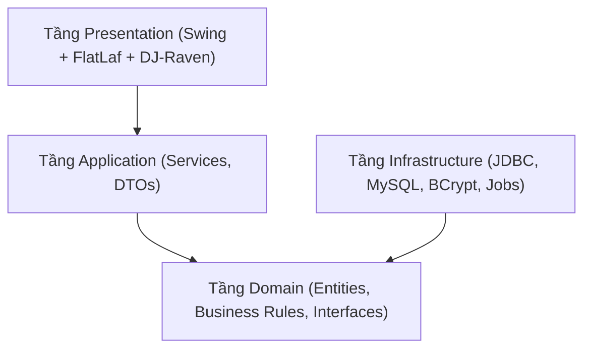

# CẨM NANG VẤN ĐÁP ĐỒ ÁN PBL — HỆ THỐNG QUẢN LÝ THƯ VIỆN XIMILIB

> **Dành cho sinh viên bảo vệ đồ án trước Hội đồng chấm thi PBL (Trường ĐH Bách Khoa - ĐH Đà Nẵng)**  
> *Phiên bản: 1.0 | Cập nhật: 10/2026 | Hệ thống: Java 17, Swing + FlatLaf, MySQL 8.4*

---

## MỤC LỤC
1. [Kiến trúc Phần mềm & Phân tầng (Clean Architecture)](#1-kiến-trúc-phần-mềm--phân-tầng)
2. [Quản lý Phụ thuộc & Pure Dependency Injection (DI)](#2-pure-dependency-injection-di)
3. [Thiết kế Cơ sở Dữ liệu & Tính Toàn vẹn Dữ liệu](#3-thiết-kế-cơ-sở-dữ-liệu--tính-toàn-vẹn)
4. [Kiểm soát Đồng thời (Concurrency Control & Deadlock Prevention)](#4-kiểm-soát-đồng-thời-concurrency-control)
5. [Quy chuẩn Thiết kế Giao diện Desktop Hiện đại (DJ-Raven Suite)](#5-quy-chuẩn-giao-diện-dj-raven-suite)
6. [Các Quy tắc Nghiệp vụ Cốt lõi (Business Rules BR-01..BR-09)](#6-các-quy-tắc-nghiệp-vụ-cốt-lõi)
7. [Bảo mật & Kiểm toán Hệ thống (Security & Audit Log)](#7-bảo-mật--kiểm-toán-hệ-thống)
8. [Tích hợp Thanh toán VietQR & Đối soát Giao dịch](#8-tích-hợp-thanh-toán-vietqr)
9. [Bộ Câu Hỏi & Câu Trả Lời Vấn Đáp Thường Gặp (Top 15 Q&A)](#9-bộ-câu-hỏi-vấn-đáp-thường-gặp)

---

## 1. Kiến trúc Phần mềm & Phân tầng
### Câu hỏi cốt lõi: *"Dự án áp dụng kiến trúc gì và luồng dữ liệu đi như thế nào?"*
- **Kiến trúc áp dụng:** **Clean Architecture 4 tầng** (`Presentation` $\rightarrow$ `Application` $\rightarrow$ `Domain` $\leftarrow$ `Infrastructure`).
- **Quy tắc phụ thuộc (Dependency Inversion Principle - DIP):** 
  - Các tầng bên ngoài phụ thuộc vào tầng bên trong.
  - Tầng Domain (ở trung tâm) không phụ thuộc vào bất kỳ thư viện bên ngoài hay cơ sở dữ liệu nào (`javax.swing`, `java.sql`, HikariCP, v.v.). Tầng Domain chỉ chứa Entities, Value Objects, Domain Events và Repository Interfaces.
  - Tầng Presentation chỉ giao tiếp với Application qua Service Interfaces và DTO (Data Transfer Object), **tuyệt đối không bao giờ gọi trực tiếp DAO hay SQL** (R-01).

---

## 2. Pure Dependency Injection (DI)
### Câu hỏi cốt lõi: *"Tại sao không dùng Spring Boot / Spring Framework mà lại tự viết DI Container?"*
- **Lý do lựa chọn:**
  1. **Hiệu năng & Khởi động nguội (Cold Boot):** XimiLib là ứng dụng Desktop (Client-side). Spring Framework có overhead lớn về Reflection, Classpath Scanning và bộ nhớ. Tự viết Pure DI qua `AppContainer` (Singleton Composition Root) giúp ứng dụng khởi động tức thì trong **dưới 1 giây**.
  2. **Kiểm soát luồng Swing EDT:** Tránh xung đột luồng phức tạp giữa Spring Context Lifecycle và Java Swing Event Dispatch Thread (EDT).
  3. **Độc lập và Trong sáng:** Dễ dàng viết Unit Test bằng cách truyền mock repository vào constructor mà không cần bất kỳ framework hay runner phức tạp nào.

---

## 3. Thiết kế Cơ sở Dữ liệu & Tính Toàn vẹn
### Câu hỏi cốt lõi: *"CSDL có bao nhiêu bảng? Làm sao chống mất mát dữ liệu khi xóa?"*
- **Cấu trúc CSDL:** Gồm **23 bảng chuẩn hóa** (BCNF / 3NF) chạy trên MySQL 8.0+ với bảng mã `utf8mb4_unicode_ci`.
- **Cơ chế Xóa mềm (Soft-Delete - R-03):**
  - Mọi bảng danh mục chính (`sach`, `theloai`, `nguoidung`, `binhluan`) đều có cờ `IsDeleted BOOLEAN DEFAULT FALSE`.
  - Khi người dùng xóa sách, hệ thống chỉ cập nhật `IsDeleted = TRUE`. Toàn bộ lịch sử phiếu mượn, phạt, thanh toán trong quá khứ vẫn được giữ nguyên toàn vẹn dữ liệu.
  - Có màn hình **Thùng rác & Khôi phục** (`TrashAndRestoreView`) cho phép Thủ thư phục hồi đầu sách khi cần.
  - **Ràng buộc nghiệp vụ BR-09:** Cấm xóa sách nếu vẫn còn bản copy đang trong trạng thái cho mượn (`activeLoansCount > 0`).

---

## 4. Kiểm soát Đồng thời (Concurrency Control)
### Câu hỏi cốt lõi: *"Nếu 2 độc giả cùng nhấn mượn 1 cuốn sách duy nhất tại cùng 1 giây, hệ thống xử lý thế nào để không bị mượn trùng?"*
- **Giải pháp:** **Khóa bi quan (Pessimistic Locking)** với câu lệnh `SELECT ... FOR UPDATE` trong Transaction JDBC.
- **Cơ chế chống Deadlock (R-05):**
  - Đặt Transaction Isolation Level là `READ COMMITTED`.
  - Khóa bản ghi theo thứ tự id tăng dần: Khóa đầu sách trước (`Masach ASC`), sau đó khóa các cuốn sách vật lý (`Macuonsach ASC`).
  - Kiểm tra điều kiện `Trangthaisach = 'KHA_DUNG'`. Nếu thỏa mãn, chuyển trạng thái sang `'DANG_MUON'` và tạo phiếu mượn; nếu thất bại hoặc xảy ra ngoại lệ, tự động `conn.rollback()`.

---

## 5. Quy chuẩn Giao diện (DJ-Raven Suite)
### Câu hỏi cốt lõi: *"Ứng dụng dùng các thư viện UI nào và tại sao không dùng JOptionPane truyền thống?"*
- **Bộ thư viện UI tích hợp:**
  1. **FlatLaf (v3.5.4):** Theme phẳng hiện đại, tương thích đa nền tảng (Windows/macOS/Linux), hỗ trợ HiDPI.
  2. **ModalDialog & Toast (`io.github.dj-raven:modal-dialog`):** Hộp thoại pop-up trượt mượt mà nằm trọn vẹn bên trong khung cửa sổ ứng dụng (In-App Overlay), loại bỏ cửa sổ popup xấu xí của OS và không làm mất focus.
  3. **GlassPanePopup (`raven.popup:swing-glasspane-popup`):** Popup nhanh hiển thị Thẻ Thư Viện Điện Tử QR và Chuông Thông Báo.
  4. **DateTime Picker (`io.github.dj-raven:swing-datetime-picker`):** Chuẩn hóa 100% việc chọn ngày tháng `dd/MM/yyyy`, ngăn chặn hoàn toàn lỗi gõ sai định dạng ngày của người dùng.
  5. **Vector Graphics (Java2D):** Sử dụng các biểu tượng vẽ bằng thuật toán tọa độ trong `IconFactory`, không phụ thuộc vào icon font nên không bao giờ bị lỗi ô vuông (`□`) trên Windows tiếng Việt.

---

## 6. Các Quy tắc Nghiệp vụ Cốt lõi
| Mã | Quy định nghiệp vụ | Hiện thực trong mã nguồn |
|---|---|---|
| **BR-01** | Khóa đăng nhập 15 phút nếu nhập sai mật khẩu 5 lần liên tiếp. | `AuthenticationServiceImpl.java` kiểm tra `Solansai` và `Khoaden`. |
| **BR-02** | Mỗi bạn đọc chỉ mượn tối đa 3 cuốn sách mang về nhà (`VE_NHA`) trong 14 ngày. | `CirculationServiceImpl.createLoan()` đếm số sách đang giữ. |
| **BR-04** | Mượn tại chỗ (`TAI_CHO`) không giới hạn số lượng nhưng phải trả trước 17:00 cùng ngày. | Thiết lập `Hantranhan` là 17:00 ngày hiện tại. |
| **BR-06** | Phạt trễ hạn: 2.000 VNĐ / ngày / cuốn sách. | `ChronoUnit.DAYS.between(dueDate, returnDate) * 2000`. |
| **BR-07** | Bạn đọc còn nợ tiền phạt chưa nộp sẽ bị hệ thống chặn mượn sách mới. | Kiểm tra `hasUnpaidFines(readerId)` trước khi tạo phiếu. |
| **BR-08** | Bồi thường mất sách: 200% giá bìa + 20.000đ phí kỹ thuật + tiền phạt quá hạn. | `CompensationResultDto` tính tổng và tạo biên lai bồi thường. |
| **R-10** | Quy trình báo mất sách: Chuyển `CHO_XU_LY_BOI_THUONG` (4) $\rightarrow$ Đóng `DA_MAT` (5) sau khi nộp phạt. | Chuyển trạng thái 2 bước khớp đặc tả SRS UC-9. |

---

## 7. Bảo mật & Kiểm toán Hệ thống
- **Mã hóa Mật khẩu:** 100% mật khẩu người dùng (Admin, Thủ thư, Bạn đọc) được băm một chiều bằng thuật toán **BCrypt** với salt ngẫu nhiên. CSDL không bao giờ lưu trữ mật khẩu dạng plain-text.
- **Phân quyền vai trò (RBAC):** Kiểm tra quyền ở cả 2 tầng:
  - Tầng giao diện: Ẩn/hiện các menu trên thanh Sidebar và nút bấm thao tác theo vai trò (`Admin`, `Librarian`, `Reader`).
  - Tầng Application Service: Bắt buộc kiểm tra quyền thực thi trước khi gọi logic nghiệp vụ (R-08).
- **Kiểm toán (Audit Log - F-06):** Mọi thao tác trọng yếu (Đăng nhập, Mượn sách, Trả sách, Báo mất, Thu tiền phạt, Xuất báo cáo) đều được tự động ghi nhận vào file `logs/audit.log` với cấu trúc chuẩn:
  `[TIMESTAMP] [AUDIT] [USER_ID] [ACTION] [DETAILS]`.

---

## 8. Tích hợp Thanh toán VietQR
- **Chuẩn thanh toán:** Tiêu chuẩn chuyển khoản nhanh **Napas247 VietQR**.
- **Cơ chế sinh mã QR động:**
  - URL mã QR: `https://img.vietqr.io/image/MB-0905123456-compact2.png?amount={SOTIEN}&addInfo=XML{MAPHIEUPHAT}&accountName=THU%20VIEN%20DHBK%20DA%20NANG`.
  - Khi độc giả chuyển khoản bằng ứng dụng ngân hàng, mã nội dung chuyển khoản `XML{Maphieuphat}` được tự động điền sẵn.
  - Hệ thống ghi nhận lịch sử vào bảng `thanhtoan` (`Phuongthuc = 'Chuyển khoản VietQR'`) và cập nhật phiếu phạt thành Đã nộp.

---

## 9. Bộ Câu Hỏi Vấn Đáp Thường Gặp (Top 15 Q&A)

### Q1: Tại sao tiền tệ trong Java dùng `BigDecimal` mà không dùng `double` hay `float`?
> **Trả lời:** `double` và `float` sử dụng chuẩn dấu phẩy động nhị phân IEEE 754, gây ra sai số làm tròn khi tính toán số học (ví dụ: `0.1 + 0.2 = 0.30000000000000004`). Trong ứng dụng tài chính/ngân hàng, bắt buộc phải dùng `BigDecimal` trong Java và `DECIMAL(12,2)` trong MySQL để đảm bảo độ chính xác tuyệt đối từng đồng tiền phạt.

### Q2: Clean Architecture khác gì so với mô hình MVC 3 lớp truyền thống?
> **Trả lời:** Mô hình 3 lớp truyền thống (`GUI -> BLL -> DAL`) làm cho tầng nghiệp vụ (BLL) phụ thuộc vào tầng dữ liệu (DAL/Database). Trong Clean Architecture, quy tắc đảo ngược phụ thuộc (DIP) được áp dụng: Tầng Domain đứng độc lập ở vị trí trung tâm, định nghĩa các Interface Repository; tầng Infrastructure bên ngoài chỉ là nơi hiện thực các interface đó. Điều này giúp hệ thống dễ dàng thay thế database hoặc viết mock test mà không cần sửa code nghiệp vụ.

### Q3: Tác vụ quét phiếu mượn quá hạn hàng ngày hoạt động như thế nào?
> **Trả lời:** Hệ thống sử dụng `BackgroundJobManager` chạy daemon thread bằng `ScheduledExecutorService`. Cứ mỗi 1 giờ, hệ thống quét bảng `phieumuon`: những phiếu nào đang ở trạng thái 1 (`DANG_MUON`) mà `Hantranhan < NOW()` sẽ tự động chuyển sang trạng thái 3 (`QUA_HAN`). Khi người dùng mở ứng dụng, tác vụ này cũng được kích hoạt ngay lập tức.

### Q4: Nếu mất kết nối Internet, tính năng thanh toán VietQR có hoạt động được không?
> **Trả lời:** Có. `VietQrModalPanel` đã được thiết kế cơ chế Fallback an toàn: Nếu không tải được ảnh QR từ máy chủ VietQR, hệ thống sẽ tự động hiển thị bảng thông tin tài khoản ngân hàng trực quan (Số tài khoản, Chủ tài khoản, Số tiền, Nội dung chuyển khoản) để thủ thư và bạn đọc vẫn thực hiện giao dịch bình thường.

### Q5: Tại sao file Excel xuất ra mở bằng Microsoft Excel trên Windows không bị lỗi font tiếng Việt?
> **Trả lời:** Do hệ thống đã chủ động ghi 3 byte **UTF-8 BOM** (`0xEF, 0xBB, 0xBF`) vào đầu luồng file CSV trước khi ghi nội dung văn bản. Nhờ có BOM, Microsoft Excel trên Windows sẽ tự động nhận diện bảng mã UTF-8 thay vì mở bằng bảng mã mặc định Windows-1258/ANSI.

---
*Chúc các bạn sinh viên tự tin bảo vệ đồ án và đạt kết quả xuất sắc nhất!*
